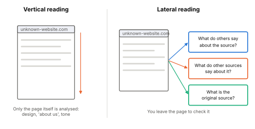
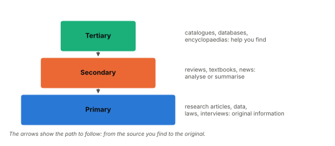
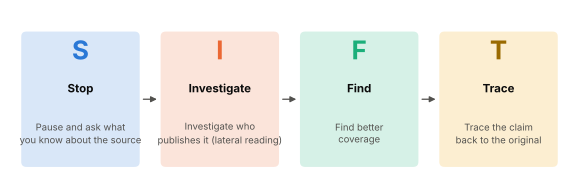

# Unit 1. Introduction. Information sources {#sec-u1}

::: {.callout-note appearance="default"}
## Objectives
- Recognise information overload and the different types of false information.
- Use digital information critically, reflectively and proactively.
- Identify, select and evaluate information sources, including social media as a scientific source.
:::

::: {.callout-note appearance="simple" icon="false"}
## Unit glossary
[Information overload](92-glossary.qmd#gl-sobrecarga) · [Disinformation](92-glossary.qmd#gl-desinformacion) · [Misinformation](92-glossary.qmd#gl-erronea) · [Credibility](92-glossary.qmd#gl-credibilidad) · [Lateral reading](92-glossary.qmd#gl-lateral) · [SIFT method](92-glossary.qmd#gl-sift) · [Primary source](92-glossary.qmd#gl-primaria) · [Peer review](92-glossary.qmd#gl-pares) · [Altmetrics](92-glossary.qmd#gl-altmetria)
:::

::: {.callout-tip appearance="simple" icon="false"}
## Downloads
[Challenge submission template (.qmd)](plantillas/entrega_reto.qmd){.btn .btn-outline-primary .btn-sm download="entrega_reto.qmd"}
[Style theme (.scss)](plantillas/informe.scss){.btn .btn-outline-primary .btn-sm download="informe.scss"}

Use the `.qmd` template and its `.scss` theme to write up your challenges: save them in the same folder.
:::

## Required reading

::: {.lectura}
Metzger, M. J.; Flanagin, A. J. (2013). [Credibility and trust of information in online environments: The use of cognitive heuristics](https://doi.org/10.1016/j.pragma.2013.07.012). *Journal of Pragmatics*, 59, 210-220.
:::

### Further reading {.unnumbered}

- Bawden, D.; Robinson, L. (2009). [The dark side of information: Overload, anxiety and other paradoxes and pathologies](https://doi.org/10.1177/0165551508095781). *Journal of Information Science*, 35(2), 180-191. Information overload and its effects.
- Pennycook, G.; Rand, D. G. (2021). [The psychology of fake news](https://doi.org/10.1016/j.tics.2021.02.007). *Trends in Cognitive Sciences*, 25(5), 388-402. Why we believe and share fake news.
- Sugimoto, C. R.; Work, S.; Larivière, V.; Haustein, S. (2017). [Scholarly use of social media and altmetrics: A review of the literature](https://doi.org/10.1002/asi.23833). *Journal of the Association for Information Science and Technology*, 68(9), 2037-2062.

## 1. Information, overload and false information

Accessing information has never been so easy, and knowing which information is reliable has never been so hard. Bawden and Robinson (2009) describe the "dark side" of information: **information overload** (more information than can be processed), the anxiety it causes and other paradoxical effects, such as feeling less informed the more information you receive.

When it comes to false information, it is useful to distinguish:

| Type | What it is | Example |
|---|---|---|
| **Misinformation** | False, but shared without intending to deceive | Forwarding an ineffective home remedy believing it works |
| **Disinformation** | False and created or spread to deceive | A campaign with invented data to influence an election |
| **Malinformation** | True, but used to cause harm | Publishing someone's real personal data |

Pennycook and Rand (2021) show that many people share false information not so much because of ideological bias as because of **inattention**: they do not stop to think whether it is true before sharing it. A short pause improves judgement.

## 2. Critical, reflective and proactive use

Metzger and Flanagin (2013) explain that, online, people do not assess credibility systematically but with **mental shortcuts** (heuristics): **reputation** (a well-known brand seems reliable), **endorsement** by others (many reviews or likes), **consistency** (what is repeated on several sites), **expectancy violation** (a sloppy design or errors make us suspicious) and **persuasive intent** (if it looks like they want to sell us something, we distrust it). These shortcuts are useful, but they can be exploited: a fake website can imitate a well-known brand and reviews can be bought.

Using information critically means replacing the shortcut with a check when it matters. For this, **lateral reading** works better than vertical reading: instead of analysing the page in depth (it may be designed to look reliable), you open other tabs to find out what **others** say about that source and that claim. This is what professional fact-checkers do.

The **SIFT** method, proposed by Mike Caulfield, sums up lateral reading in four steps:

1. **Stop**: before reading or sharing, ask yourself whether you know the source.
2. **Investigate the source**: who is behind it and what interests do they have?
3. **Find better coverage**: what do other reliable sources say about the same thing?
4. **Trace claims**: find the primary source of the claim, quote or image.

{#fig-lateral fig-alt="On the left, a single web page with an arrow running down it: vertical reading. On the right, the same page with arrows leading out to three tabs: what others say about the source, what other sources say about the same thing and the original source of the claim."}

## 3. Identifying, selecting and evaluating sources

Sources are usually classified as **primary** (original information: a research article, a dataset, a law, an interview), **secondary** (they analyse or summarise primary sources: a review, a textbook, a news story about a study) and **tertiary** (they help you find the others: catalogues, databases, encyclopaedias).

To select them, the key question is **what do I need**: a definition, up-to-date data, the scientific evidence on a topic, the legislation in force. To evaluate them, a useful checklist is:

| Criterion | Questions |
|---|---|
| **Authorship** | Who signs it? Do they know the subject? Is there a responsible organisation? |
| **Purpose** | Does it inform, give an opinion, sell, persuade? |
| **Currency** | When was it published or updated? Does the date matter for your topic? |
| **Accuracy** | Does it cite its sources? Can it be checked? Does it agree with other reliable sources? |
| **Review** | Has it passed peer review, professional editing or no check at all? |

{#fig-fuentes fig-alt="Three stacked levels: at the top, tertiary sources (catalogues, databases, encyclopaedias, which help you find); in the middle, secondary sources (reviews, textbooks, news, which analyse or summarise); at the bottom, primary sources (research articles, data, laws, interviews: original information). Arrows run down from tertiary to primary sources."}

## 4. Social media as a source of scientific information

Social media is increasingly used to spread and discuss science. Sugimoto et al. (2017) review how researchers use it and how these mentions are measured (**altmetrics**). For a student, social media can help you **discover** recent research and debates, but it is not the source: you need to get to the original article. Remember that:

- A viral post about a study may exaggerate or misinterpret its results.
- Social media mentions measure **attention**, not quality or truth.
- Preprints (versions before peer review) spread widely on social media and may change or never be published.

## 5. Disinformation and libraries: the IFLA infographic

In 2017 the International Federation of Library Associations and Institutions (IFLA) published the infographic *How to Spot Fake News*, adapted from a 2016 FactCheck.org article. It starts from one idea: **critical thinking** is a key skill of **media and information literacy**, and libraries should teach and defend it. IFLA offers it for download, printing, translation and sharing in libraries, communities and social media.

| Step | What the infographic proposes | In practice |
|---|---|---|
| **1. Consider the source** | Investigate the website, its mission and its contact information | Who publishes it? Is there a real "About us" and contact? |
| **2. Read beyond** | A striking headline seeks attention: what is the whole story? | Read the whole text, not just the headline or thumbnail |
| **3. Check the author** | A quick search: are they credible? Are they real? | Look for their professional profile or ORCID |
| **4. Supporting sources** | Click the links and check that the information supports the story | Trace the claim back to the original study or document |
| **5. Check the date** | Reposting old news does not make it relevant to current events | Look at the date of publication and of the data |
| **6. Is it a joke?** | If it is too outlandish, it may be satire | Check whether the outlet is satirical |
| **7. Check your biases** | Your own beliefs can affect your judgement | Be more suspicious of what confirms what you already thought |
| **8. Ask the experts** | Ask a librarian or consult a fact-checking site | University libraries, fact-checkers such as Full Fact or Maldita.es |

IFLA's eight steps and SIFT's four moves (worked example 1) complement each other: SIFT organises the process into four quick moves based on lateral reading, and IFLA breaks down what to check in each source. Step 7, **checking your own biases**, is perhaps the hardest: we tend to accept without checking whatever matches our ideas (confirmation bias).

::: {.callout-tip appearance="simple" icon="false"}
## Downloadable resource
IFLA (2017). *How to Spot Fake News* [Infographic]. International Federation of Library Associations and Institutions. <https://repository.ifla.org/handle/20.500.14598/195> (available in English and in many other languages)
:::

## Worked examples

::: {.callout-note appearance="simple" icon="false"}
## Example 1 · A news story about a study: lateral reading with SIFT
A headline says: "Study proves that sleeping less than six hours doubles the risk of failing". The **SIFT** method (Mike Caulfield) proposes four quick moves:

{#fig-u1-sift fig-alt="Four blocks in sequence: S, Stop, pause and ask what you know about the source; I, Investigate who publishes it through lateral reading; F, Find better coverage; T, Trace the claim back to the original."}

1. **Stop**: before sharing or believing it, ask yourself what you know about the source and how the headline makes you feel. A bold, emotional headline calls for more care.
2. **Investigate the source**: open another tab and find out who publishes the story (an outlet with a science desk, a commercial blog?). This is **lateral reading**: you evaluate a source by reading what others say about it, not what it says about itself.
3. **Find better coverage**: look for the topic in other reliable sources; if it is important, other outlets or agencies will have reported it.
4. **Trace claims**: find the original study (title, journal, DOI) and compare: is it an observational study? With how many people? Does it say "doubles" or "is associated with"?

**Typical result:** the original study found an **association** in a survey of students at one university; the headline turned it into a general causal relationship. The correct claim would be: "In a survey, students who slept less than six hours failed more subjects".
:::

::: {.callout-note appearance="simple" icon="false"}
## Example 2 · Is this journal reliable?
You receive an email inviting you to publish your bachelor's thesis in an "international, indexed journal with review in 72 hours" for €150. Checks, in order:

1. **Is it in recognised directories?** If it is open access, look for it in DOAJ (Directory of Open Access Journals). Check its ISSN on the ISSN portal.
2. **Where does it say it is indexed?** "Indexed" means nothing unless it says where; check in the databases themselves (Scopus, Web of Science, Dialnet, Latindex).
3. **Editorial board**: do these people exist? Do they know they are on the board? Are they from the field?
4. **Review**: serious peer review is not done in 72 hours.
5. **Checklist**: the *Think. Check. Submit.* initiative sums up these questions.

**Conclusion:** the combination of an unsolicited invitation, promised speed, vague indexing and a fee suggests a **predatory journal**. Do not send your work.
:::

::: {.callout-note appearance="simple" icon="false"}
## Example 3 · A viral thread about a preprint
A thread on social media announces a "discovery" and links to medRxiv. What you need to know: a **preprint** is work that has **not yet been peer reviewed**. It can be valuable and fast, but it should be read with caution: check whether it has already been published in a journal (the preprint page usually links to it), whether other specialists have commented on it and whether the thread exaggerates the results. When you cite it, always say it is a preprint.
:::

## Graded exercises

**Basic.** Classify these sources as primary, secondary or tertiary: an article presenting an experiment; an encyclopaedia; a systematic review.

::: {.webex-solution boton="See solution"}
Experiment: **primary** (it presents new data). Systematic review: **secondary** (it synthesises primary studies). Encyclopaedia: **tertiary** (it summarises and points to other sources).
:::

**Intermediate.** Apply the four SIFT moves to a science news story from this week and write five lines on what changes between the headline and the original study.

::: {.webex-solution boton="See guidance"}
Check at least: who publishes it, whether there is other coverage, the design of the original study (experimental or observational), the sample size and whether the verb in the headline ("proves", "causes") matches what the study says ("is associated with", "suggests").
:::

**Advanced.** Choose a journal in your field that you do not know and write a short report on its reliability using the five criteria in example 2 and the sources you consulted.

::: {.webex-solution boton="See guidance"}
A good report cites verifiable evidence (a link to DOAJ or the database, editorial board names that have been checked, the published review and fee policy) and distinguishes between what has been checked and what could not be verified.
:::

## Activities

::: {.clasificar #ia-u1-ifla titulo="Which step of the IFLA infographic would you apply first?" categorias="Check the date|Is it a joke?|Check your biases|Supporting sources|Check the author"}
- A 2019 story about a border closure is circulating today as if it were new → Check the date
- An incredible headline on a website whose slogan is "news that never happened" → Is it a joke?
- An article that confirms exactly what you have always thought about a controversial topic → Check your biases
- "A study proves…" with no link or reference to the study → Supporting sources
- A column signed by an "expert" with no professional trace you can find → Check the author
:::

::: {.clasificar #ia-u1-falsa titulo="What type of false information is it?" categorias="Misinformation|Disinformation|Malinformation"}
Decide whether each case is misinformation, disinformation or malinformation.

- Your aunt forwards a flu remedy on WhatsApp that she believes works → Misinformation // It is false, but she shares it without intending to deceive.
- A network of fake accounts spreads a doctored video of a candidate the night before an election → Disinformation // False and created to deceive.
- Someone publishes a journalist's real address so that she is harassed → Malinformation // It is true, but used to cause harm.
- A newspaper mistakenly publishes a wrong unemployment figure and corrects it the next day → Misinformation // An unintentional error; the correction is good practice.
- A website imitates a newspaper's design to spread an invented story → Disinformation // It impersonates a well-known brand to deceive.
- Authentic private emails of a scientist are leaked, taken out of context, to discredit him → Malinformation // Real material used to harm.
:::

::: {.clasificar #ia-u1-heuristicos titulo="Which mental shortcut is at work?" categorias="Reputation|Endorsement|Consistency|Expectancy violation|Persuasive intent"}
Metzger and Flanagin (2013) describe five credibility heuristics. Identify which one is at work in each situation.

- You trust an article because it appears on the website of a well-known university → Reputation
- You choose a hotel because it has 4,000 five-star reviews → Endorsement
- You believe a figure because you have seen it on three different websites → Consistency // Beware: three websites may copy the same source.
- You distrust a website full of spelling mistakes and pop-up ads → Expectancy violation
- You doubt a study on sugar funded by a soft-drink manufacturer → Persuasive intent
:::

::: {.clasificar #ia-u1-tipos titulo="Primary, secondary or tertiary" categorias="Primary|Secondary|Tertiary"}
- An article presenting the results of an experiment → Primary
- The dataset of a survey by the Spanish National Statistics Institute (INE) → Primary
- A systematic review on mobile phone use in class → Secondary
- A news story summarising a study → Secondary
- The text of the EU AI Act published in the Official Journal of the EU → Primary
- A university textbook → Secondary
- The university library catalogue → Tertiary
- A bibliographic database such as Dialnet → Tertiary
:::

::: {.ordenar #ia-u1-sift titulo="The SIFT steps"}
1. Stop before reading or sharing
2. Investigate who is behind the source
3. Find better coverage in other reliable sources
4. Trace the claim back to its origin
:::

::: {.escenario #ia-u1-escenario titulo="A headline about coffee"}
A friend shares on social media: "Study proves three coffees a day cut the risk of Alzheimer's by 60%". It has 20,000 likes. (An invented case for practice.)

### You see it on your phone {#u1e-inicio}
What do you do?

- [I share it: it has lots of likes and I like coffee](#u1e-compartir)
- [I stop and look at who published it](#u1e-fuente)

### Shared {#u1e-compartir .final .mal}
You used the endorsement heuristic: likes measure popularity, not truth. And you have amplified something without checking it.

### Who published it? {#u1e-fuente}
The post links to a website called "naturalhealthtoday.info" that you do not know.

- [I read the website carefully: if it looks serious, I trust it](#u1e-vertical)
- [I open another tab and search for what is said about that website](#u1e-lateral)

### Vertical reading {#u1e-vertical .final .regular}
The website has a good design and a very professional "About us" page. But design can be imitated: without leaving the page you do not know who is behind it. Try lateral reading.

### Lateral reading {#u1e-lateral}
You discover that the website sells food supplements. You look for the headline in other sources.

- [I look for the original study](#u1e-original)
- [It is enough that other similar websites publish it](#u1e-coherencia)

### Misleading consistency {#u1e-coherencia .final .mal}
Many websites copy the same press release: repetition is not verification. You still need to get to the original.

### The original study {#u1e-original}
You find the article: it is an observational study that finds a modest **association** between coffee consumption and lower risk, and it warns that it does not prove causation. There is no "60%" for three coffees.

- [I conclude that the headline exaggerates and I do not share it (or I share it with the context)](#u1e-bien)
- [I conclude that the study is fake](#u1e-extremo)

### Well-calibrated judgement {#u1e-bien .final .bien}
You have made the four SIFT moves: stop, investigate the source, find better coverage and trace the original. The headline is **exaggerated**, not entirely false: it confuses association with cause and invents the figure.

### Too far {#u1e-extremo .final .regular}
The study exists and is legitimate; what fails is the headline. Distinguish between the original source and how it has been reported.
:::

::: {.callout-warning appearance="simple" icon="false"}
## Common mistakes
- **Confusing popularity with reliability.** Likes, views and mentions measure attention.
- **Staying on the page.** A good design or a convincing "About us" proves nothing: leave the page.
- **Taking repetition as confirmation.** Ten websites copying the same press release are a single source.
- **Reading only the headline.** The headline summarises (and sometimes exaggerates) what the study says; read at least the original abstract.
- **Distrusting everything.** The goal is not total scepticism but calibrating your trust to the evidence.
:::

## Practice

Choose a striking claim you have seen on social media this week. Apply the four SIFT steps and note how long it took you and what you found at each step. Compare it with what you would have concluded by reading only the post.

## Assessed challenge {#reto-u1}

::: {.callout-important appearance="simple" icon="false"}
## Unit 1 challenge · Verify a scientific claim
Choose a claim related to science or health that is circulating on social media or in the media:

1. Apply the **SIFT** method and document each step with screenshots and links.
2. Find the **primary source** (the original study, report or data) and compare what it says with what is claimed.
3. Evaluate **three sources** you used with the criteria table in section 3.
4. Conclude whether the claim is true, false, exaggerated or unverifiable, and explain why.

**Submission:** a report made with the [submission template](plantillas/entrega_reto.qmd). It is assessed with the rubric included in the template. This challenge **has no solution in the book**: each student chooses a different claim and the teaching staff mark it.
:::

## Self-assessment

Answer all the questions and press **Show answers**: correct answers turn green, wrong ones red, and you will see your score. You can change your answers and check again. It does not count towards your mark.

::: {.webex-check .webex-box}
1. Forwarding an ineffective home remedy believing it works is a case of 
2. According to Pennycook and Rand, many people share fake news mainly through a lack of 
3. Lateral reading consists of analysing the page itself in depth before leaving it. 
4. The last SIFT step, tracing to the original, looks for the  source
5. Which heuristic do we use when we trust a website because it has many positive reviews? 
6. A review article summarising many studies is a  source
7. What do social media mentions of an article measure?



8. Spreading someone's real personal data to harm them is 
9. A law published in the Spanish Official State Gazette (BOE) is a  source
10. A preprint has already passed peer review. 
:::

::: {.webex-solution boton="See explanations"}
- It is false, but without intent to deceive.
- A pause to think improves judgement.
- That is vertical reading; lateral reading leaves the page to check it.
- The original source of the claim.
- Endorsement by others: reviews, likes, recommendations.
- It summarises and analyses primary sources.
- Altmetrics measure attention, not quality or truth.
- It is true, but used to cause harm.
- It is the original text of the law.
- It is a version before review.
:::

## Further resources

| Resource | What it is for |
|---|---|
| [IFLA – How to Spot Fake News (2017)](https://repository.ifla.org/handle/20.500.14598/195) | Eight-step infographic for spotting fake news, in many languages |
| [Caulfield, M. – SIFT (The four moves)](https://hapgood.us/2019/06/19/sift-the-four-moves/) | The SIFT method explained by its author |
| [ACRL – Framework for Information Literacy](https://www.ala.org/acrl/standards/ilframework) | Framework for information literacy |
| [Full Fact](https://fullfact.org/), [Maldita.es](https://maldita.es/) and [Newtral](https://www.newtral.es/) | Fact-checkers in the UK and Spain |
| [IFCN – Code of principles](https://ifcncodeofprinciples.poynter.org/) | International fact-checking network |
| [*The information literacy user's guide*](https://milnepublishing.geneseo.edu/the-information-literacy-users-guide-an-open-online-textbook/) | Open textbook from the core bibliography |
