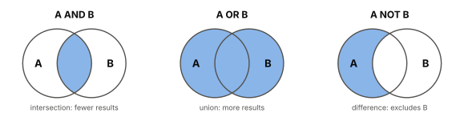
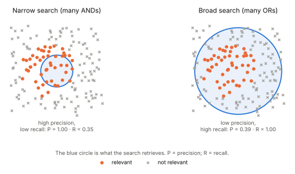

# Unit 2. Information retrieval {#sec-u2}

::: {.callout-note appearance="default"}
## Objectives
- Apply the principles and strategies of information retrieval.
- Use general and specialised resource platforms.
- Organise the information you find.
:::

::: {.callout-note appearance="simple" icon="false"}
## Unit glossary
[Information need](92-glossary.qmd#gl-necesidad) · [Boolean operator](92-glossary.qmd#gl-booleano) · [Truncation](92-glossary.qmd#gl-truncamiento) · [Field searching](92-glossary.qmd#gl-campos) · [Precision](92-glossary.qmd#gl-precision) · [Recall](92-glossary.qmd#gl-exhaustividad) · [Berrypicking](92-glossary.qmd#gl-bayas) · [Controlled vocabulary](92-glossary.qmd#gl-controlado)
:::

::: {.callout-tip appearance="simple" icon="false"}
## Downloads
[Chapter R script](plantillas/02_retrieval.R){.btn .btn-outline-primary .btn-sm download="02_retrieval.R"}
[Challenge submission template (.qmd)](plantillas/entrega_reto.qmd){.btn .btn-outline-primary .btn-sm download="entrega_reto.qmd"}
[Style theme (.scss)](plantillas/informe.scss){.btn .btn-outline-primary .btn-sm download="informe.scss"}
:::

## Required reading

::: {.lectura}
Bates, M. J. (1989). [The design of browsing and berrypicking techniques for the online search interface](https://doi.org/10.1108/eb024320). *Online Review*, 13(5), 407-424.
:::

### Further reading {.unnumbered}

- Marchionini, G. (2006). [Exploratory search: From finding to understanding](https://doi.org/10.1145/1121949.1121979). *Communications of the ACM*, 49(4), 41-46. Searching as learning.
- Cruz Gil, C. (2015). *Modelos de búsqueda y recuperación de la información*. Trea (core course bibliography).
- Pacios Lozano, A. R. (coord.) (2013). *Técnicas de búsqueda y uso de la información*. Ramón Areces (core bibliography).

## 1. From the need to the strategy

Every search begins with an **information need**: what you want to know and why. Before typing anything into a search engine:

1. **Formulate the question** in one sentence: "How does mobile phone use affect university students' academic performance?".
2. **Identify the concepts**: mobile phone use, academic performance, university students.
3. **Find synonyms and related terms** for each concept, in English and, if useful, in other languages (*smartphone*, *mobile phone*, *cell phone*; *academic performance*, *achievement*; *university students*, *undergraduates*).
4. **Decide the limits**: language, dates, type of document.

Bates (1989) showed that real searching is not a single query that returns the perfect set, but a process she called ***berrypicking***: the need changes as you read, you pick up useful pieces at each step and you use a variety of techniques (following an article's references, searching for an author, browsing a journal). Marchionini (2006) calls **exploratory search** the kind that is used to learn about a topic, as opposed to looking up a single fact.

## 2. Operators and techniques

| Technique | What it does | Example |
|---|---|---|
| **AND** | All the terms: reduces results | `mobile AND performance` |
| **OR** | Any of the terms: broadens (synonyms) | `mobile OR smartphone` |
| **NOT** | Excludes a term | `performance NOT sports` |
| **Parentheses** | Group and order the operations | `(mobile OR smartphone) AND performance` |
| **Quotation marks** | Exact phrase | `"academic performance"` |
| **Truncation** | Variants of a stem | `universit*` finds university, universities… |
| **Field searching** | Only in title, author, abstract… | `title:(smartphone)` depending on the platform |

Each platform has its own syntax; each search engine's help pages explain it. In addition, many databases use a **controlled vocabulary** (thesauri, subject headings): standardised terms that group synonyms and improve results.

{#fig-booleanos fig-alt="Three Venn diagrams with two circles, A and B. In the first, labelled A AND B, only the overlap is shaded. In the second, A OR B, both whole circles are shaded. In the third, A NOT B, circle A is shaded without the overlap."}

## 3. Precision and recall

Two classic measures describe a search:

- **Precision**: of what I have found, what proportion is useful?
- **Recall**: of everything that would be useful, what proportion have I found?

They usually move in opposite directions: adding synonyms with OR increases recall and lowers precision; adding concepts with AND increases precision and lowers recall. A class assignment needs precision above all; a literature review needs recall.

{#fig-precision fig-alt="Two panels with the same points: orange dots are relevant documents and grey crosses are not. On the left, a small circle (narrow search) contains only relevant points but leaves most of them out: precision 1.00 and recall 0.35. On the right, a large circle (broad search) contains all the relevant points and many crosses: precision 0.39 and recall 1.00."}

## 4. General and specialised platforms

| Type | Examples | What for |
|---|---|---|
| General search engines | Google, Bing | General information, institutional websites, news |
| Academic search engines | [Google Scholar](https://scholar.google.com/), [BASE](https://www.base-search.net/), [OpenAlex](https://openalex.org/) | Scientific literature in all fields |
| Library catalogues | UC3M library catalogue | Books and resources subscribed to by the university |
| Multidisciplinary databases | Web of Science, Scopus (with university access), [Dialnet](https://dialnet.unirioja.es/) | Peer-reviewed articles, with filters and controlled vocabulary; Dialnet for literature in Spanish |
| Specialised databases | [PubMed](https://pubmed.ncbi.nlm.nih.gov/) (biomedicine), ERIC (education), LISTA (library science) | Comprehensive searching in one field |
| Repositories | [Recolecta](https://www.recolecta.fecyt.es/), institutional repositories | Open access versions |

Some resources require you to log in with your university account or use the VPN from outside the campus.

## 5. Organising information

Finding is half the job: the other half is not losing what you found. It helps to:

- **Save your search strategy** (where, with which terms, when and how many results), so you can repeat it and explain it.
- Use a **reference manager** (Unit 4) to save documents with their details.
- Set up **alerts** in databases to receive new results.
- Take notes with the full reference from the start, so you do not have to look for it later.

## R practice: Boolean operators from the inside

A search engine treats each term as the **set** of documents that contain it. In R, `intersect()` is AND, `union()` is OR and `setdiff()` is NOT:

```{webr}
#| autorun: true
mobile      <- c(1, 2, 3, 5, 8, 13, 21)     # documents containing "mobile"
smartphone  <- c(2, 4, 8, 16, 32)           # those containing "smartphone"
performance <- c(1, 2, 4, 8, 13, 16, 40)    # those containing "performance"

union(mobile, smartphone)                          # mobile OR smartphone
intersect(union(mobile, smartphone), performance)  # (mobile OR smartphone) AND performance
```

### Exercise 2.1 {.unnumbered}

How many documents does `(mobile OR smartphone) AND performance` return?

```{webr}
#| exercise: u2_and
#| setup: true
mobile      <- c(1, 2, 3, 5, 8, 13, 21)
smartphone  <- c(2, 4, 8, 16, 32)
performance <- c(1, 2, 4, 8, 13, 16, 40)
```

```{webr}
#| exercise: u2_and
r <- intersect(union(mobile, smartphone), ______)
length(r)
```

::: {.hint exercise="u2_and"}
The third concept is `performance`.
:::

::: {.solution exercise="u2_and"}
```r
r <- intersect(union(mobile, smartphone), performance)
length(r)
```
Six documents: 1, 2, 8, 13, 4 and 16. Without the synonym *smartphone* you would only have found four: adding synonyms with OR increases recall.
:::

```{webr}
#| exercise: u2_and
#| check: true
if (identical(as.integer(.result), 6L)) {
  list(correct = TRUE, message = "Correct: 6 documents.")
} else {
  list(correct = FALSE, message = "Intersect with the performance vector.")
}
```

### Exercise 2.2 {.unnumbered}

You have reviewed the six results and only four are useful. Calculate the **precision** of the search.

```{webr}
#| exercise: u2_precision
relevant <- 4
results <- 6
relevant / ______
```

::: {.hint exercise="u2_precision"}
Precision is relevant divided by results.
:::

::: {.solution exercise="u2_precision"}
```r
relevant <- 4
results <- 6
relevant / results
```
0.67: two out of three results are useful.
:::

```{webr}
#| exercise: u2_precision
#| check: true
if (isTRUE(all.equal(as.numeric(.result), 4 / 6))) {
  list(correct = TRUE, message = "Correct: precision of 0.67.")
} else {
  list(correct = FALSE, message = "Divide by results.")
}
```

## Lab: live Boolean operators {#lab-u2-openalex}

::: {.laboratorio}
::: {.laboratorio-etiqueta}
Lab · live data from OpenAlex
:::

Type two concepts (you can use OR, quotation marks and truncation within each one) and press **Search**. The book queries [OpenAlex](https://openalex.org/), an open index of more than 250 million scholarly works, and shows how many documents each combination retrieves. Watch how AND reduces, OR broadens and NOT excludes.

```{ojs}
//| echo: false
viewof consulta = {
  const f = html`<form class="lab-form">
    <div class="row g-2">
      <div class="col-md-5"><label class="form-label" for="lab-a">Concept A</label>
        <input id="lab-a" name="a" class="form-control form-control-sm" value='smartphone OR "mobile phone"'></div>
      <div class="col-md-5"><label class="form-label" for="lab-b">Concept B</label>
        <input id="lab-b" name="b" class="form-control form-control-sm" value='"academic performance"'></div>
      <div class="col-md-2 d-flex align-items-end"><button class="btn btn-primary btn-sm w-100" type="submit">Search</button></div>
    </div></form>`;
  f.value = {a: f.a.value, b: f.b.value};
  f.onsubmit = e => { e.preventDefault(); f.value = {a: f.a.value.trim(), b: f.b.value.trim()}; f.dispatchEvent(new Event("input", {bubbles: true})); };
  return f;
}
```

```{ojs}
//| echo: false
recuentos = {
  const q = s => fetch("https://api.openalex.org/works?per-page=1&search=" + encodeURIComponent(s))
    .then(r => { if (!r.ok) throw new Error(r.status); return r.json(); }).then(j => j.meta.count);
  const A = `(${consulta.a})`, B = `(${consulta.b})`;
  yield {cargando: true};
  try {
    const [a, b, y, o, n] = await Promise.all([q(A), q(B), q(`${A} AND ${B}`), q(`${A} OR ${B}`), q(`${A} NOT ${B}`)]);
    yield {a, b, y, o, n};
  } catch (e) { yield {error: true}; }
}
```

```{ojs}
//| echo: false
{
  if (recuentos.cargando) return html`<p role="status">Querying OpenAlex…</p>`;
  if (recuentos.error) return html`<p role="status">OpenAlex could not be reached (are you offline?). Try again later.</p>`;
  const filas = [["A", recuentos.a], ["B", recuentos.b], ["A AND B", recuentos.y], ["A OR B", recuentos.o], ["A NOT B", recuentos.n]];
  const max = Math.max(...filas.map(f => f[1]), 1);
  const fmt = new Intl.NumberFormat("en-GB");
  return html`<table class="table table-sm lab-tabla" role="status">
    <caption>Documents in OpenAlex for each combination</caption>
    <thead><tr><th scope="col">Search</th><th scope="col">Documents</th><th scope="col"><span class="visually-hidden">Bar</span></th></tr></thead>
    <tbody>${filas.map(([k, v]) => html`<tr><th scope="row"><code>${k}</code></th><td style="text-align:right">${fmt.format(v)}</td>
      <td style="width:50%"><div style="height:.8rem;border-radius:2px;background:#2a78d6;width:${Math.max(1, 100 * v / max)}%"></div></td></tr>`)}</tbody></table>
    <p>Check: <code>A OR B</code> = <code>A</code> + <code>B</code> − <code>A AND B</code>
    (${fmt.format(recuentos.a + recuentos.b - recuentos.y)} versus ${fmt.format(recuentos.o)}; any difference is due to the search engine).</p>`;
}
```

**Try:** add a synonym to A with OR and see how `A AND B` changes; then put a phrase in quotation marks and compare it with the same words without them.
:::

## Worked examples

::: {.callout-note appearance="simple" icon="false"}
## Example 1 · From the question to the search string
**Question:** how does mobile phone use affect university students' academic performance?

1. **Split the question into concepts:** (a) mobile phone, (b) academic performance, (c) university students.
2. **Gather synonyms and variants** for each concept:

| Concept | Terms |
|---|---|
| Mobile phone | smartphone*, "mobile phone*", "cell phone*" |
| Academic performance | "academic performance", "academic achievement", grades |
| University students | universit*, "higher education", "college student*" |

3. **Combine with OR within each concept and with AND between concepts:**

`(smartphone* OR "mobile phone*" OR "cell phone*") AND ("academic performance" OR "academic achievement" OR grades) AND (universit* OR "higher education" OR "college student*")`

4. **Limit the fields** if there is too much noise: search in title, abstract and keywords (in Scopus, `TITLE-ABS-KEY(...)`).
5. **Document** the database, the date, the exact search string and the number of results.
:::

::: {.callout-note appearance="simple" icon="false"}
## Example 2 · Too many or too few results
- **12,000 results (low precision):** restrict to title and abstract; add a concept with AND; filter by year, language or document type; use exact phrases in quotation marks.
- **8 results (low recall):** add synonyms with OR; use truncation (`educa*` retrieves education, educational, educator…); remove the least essential concept; search more databases; check the references of relevant articles ("snowball" searching).
:::

::: {.callout-note appearance="simple" icon="false"}
## Example 3 · The same search on three platforms
| Platform | Strength | Watch out for |
|---|---|---|
| **Dialnet** | Literature in Spanish, journals and theses from Spanish universities | Less international coverage |
| **Scopus / Web of Science** | Selected international coverage, field searching, citations | Access through institutional subscription; less literature in Spanish |
| **Google Scholar** | Breadth, full text, free versions | Low precision, no reproducible search; limited operators (`intitle:`, quotation marks, `-`) |

It is best to combine them: start in a specialised or multidisciplinary database and complete with Google Scholar to find the full text.
:::

## Graded exercises

**Basic.** What does `educa* AND (virtual OR online)` retrieve?

::: {.webex-solution boton="See solution"}
Documents containing any word beginning with *educa* (education, educational, educator…) **and** at least one of the words *virtual* or *online*.
:::

**Intermediate.** Write the search string for the question: "What effect does gamification have on secondary school students' motivation?".

::: {.webex-solution boton="See solution"}
One possible solution: `(gamif* OR "serious game*" OR "game-based learning") AND (motivat* OR engagement) AND ("secondary school*" OR "secondary education" OR "high school*")`. Others are correct if they keep the structure: OR within each concept, AND between concepts.
:::

**Advanced.** Run your search string in two databases, note the results, review the first 20 in each and calculate what proportion is relevant (approximate precision). Propose an adjustment to improve it.

::: {.webex-solution boton="See guidance"}
Present a table with database, date, search string, number of results and relevant documents among the first 20. The adjustment must be justified: if precision is low, restrict fields or add concepts; if known key documents are missing, add synonyms.
:::


## Activities

::: {.ordenar #ia-u2-proceso titulo="From the need to the search"}
1. Formulate the question in one sentence
2. Identify the main concepts
3. Find synonyms and variants for each concept
4. Combine the terms with operators
5. Choose the platforms and adapt the syntax
6. Review the results and reformulate the search
:::

::: {.clasificar #ia-u2-plataformas titulo="Where would you look first?" categorias="Academic search engine|Specialised database|Library catalogue|Repository|General search engine"}
- A textbook from the core bibliography, to borrow it → Library catalogue
- All published clinical trials on a drug → Specialised database // PubMed, for example.
- The open access version of an article from a Spanish university → Repository
- A first look at the literature of any discipline → Academic search engine
- The official website of a public body → General search engine
- Articles on education with their own thesaurus → Specialised database // ERIC has its own thesaurus.
:::

::: {.clasificar #ia-u2-operadores titulo="Which technique would you use?" categorias="AND|OR|NOT|Quotation marks|Truncation"}
- Retrieve "library", "libraries" and "librarian" at the same time → Truncation
- Add the synonym "smartphone" to "mobile" → OR
- Require both "disinformation" and "vaccines" to appear → AND
- Search for exactly "information literacy" → Quotation marks
- Exclude results about sports performance → NOT
:::

::: {.callout-warning appearance="simple" icon="false"}
## Common mistakes
- **Searching with a whole sentence** ("how does the mobile phone affect university students' performance"): the search engine does not understand the question; separate the concepts.
- **Forgetting other languages.** Most scientific literature is in English, but literature on local topics may be in Spanish or another language; search in both when relevant.
- **Sticking to the first page** of a search engine sorted by relevance without checking the filters.
- **Not saving the strategy.** If you do not note where, when and with which terms you searched, you will not be able to repeat or justify it.
- **Using NOT freely**: it also excludes useful documents that mention the term in passing.
:::

## Assessed challenge {#reto-u2}

::: {.callout-important appearance="simple" icon="false"}
## Unit 2 challenge · A documented search strategy
Choose a topic you are interested in related to your degree:

1. Formulate the **question**, identify the concepts and make a **table of terms** with synonyms and variants.
2. Build the **search string** with operators, parentheses, quotation marks and truncation.
3. Run it on **three platforms** of different types (an academic search engine, a database and a catalogue or repository), adapting the syntax. Note the results for each one.
4. Select the **five** most relevant **documents**, explain why and calculate the precision of the first page of results on each platform.

**Submission:** a report made with the [submission template](plantillas/entrega_reto.qmd). It is assessed with the rubric included in the template. This challenge **has no solution in the book**: each student chooses a different topic and the teaching staff mark it.
:::

## Self-assessment

Answer all the questions and press **Show answers**: correct answers turn green, wrong ones red, and you will see your score. You can change your answers and check again. It does not count towards your mark.

::: {.webex-check .webex-box}
1. To broaden a search with synonyms you use the operator 
2. `universit*` is an example of 
3. Adding concepts with AND usually increases precision and reduces recall. 
4. According to Bates, real searching is a single query that returns the perfect set of documents. 
5. If I find 20 documents and 5 are useful, precision is 
6. What are quotation marks used for in a search?



7. To search the biomedical literature comprehensively, the most suitable platform is 
8. The proportion of all relevant documents that a search retrieves is its 
9. A thesaurus is an example of a  vocabulary
10. In `(mobile OR smartphone) AND performance`, the parentheses make OR be resolved before AND. 
:::

::: {.webex-solution boton="See explanations"}
- OR adds sets together: any of the terms.
- The asterisk retrieves all endings of the stem.
- Each AND requires one more concept: fewer, more relevant results.
- It is a berrypicking process that changes as you read.
- 5 / 20 = 0.25.
- Quotation marks fix the whole phrase, in order.
- PubMed is the specialised biomedical database.
- Recall is also called sensitivity.
- It standardises terms and groups synonyms.
- Just like in an arithmetic operation.
:::

## Further resources

| Resource | What it is for |
|---|---|
| [OpenAlex](https://openalex.org/) | Open index of the scientific literature |
| [BASE](https://www.base-search.net/) | Search engine for open access academic documents |
| [Dialnet](https://dialnet.unirioja.es/) | Scientific literature in Spanish |
| [Recolecta](https://www.recolecta.fecyt.es/) | Spanish open access repositories |
| [*The information literacy user's guide*, search chapters](https://milnepublishing.geneseo.edu/the-information-literacy-users-guide-an-open-online-textbook/) | Open textbook |
