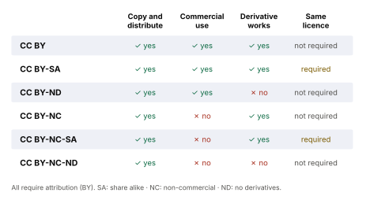
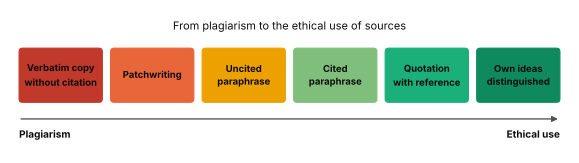
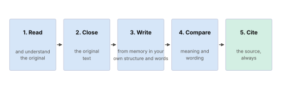

# Unit 3. Ethical use of information and plagiarism {#sec-u3}

::: {.callout-note appearance="default"}
## Objectives
- Know the basics of intellectual property and the right of quotation.
- Recognise the different types of plagiarism.
- Produce academic work without plagiarism: quote, paraphrase and summarise correctly.
:::

::: {.callout-note appearance="simple" icon="false"}
## Unit glossary
[Intellectual property](92-glossary.qmd#gl-propiedad) · [Right of quotation](92-glossary.qmd#gl-cita) · [Public domain](92-glossary.qmd#gl-dominio) · [Creative Commons licence](92-glossary.qmd#gl-cc) · [Plagiarism](92-glossary.qmd#gl-plagio) · [Paraphrase](92-glossary.qmd#gl-parafrasis) · [Patchwriting](92-glossary.qmd#gl-mosaico) · [Academic integrity](92-glossary.qmd#gl-integridad)
:::

::: {.callout-tip appearance="simple" icon="false"}
## Downloads
[Chapter R script](plantillas/03_ethics_plagiarism.R){.btn .btn-outline-primary .btn-sm download="03_ethics_plagiarism.R"}
[Challenge submission template (.qmd)](plantillas/entrega_reto.qmd){.btn .btn-outline-primary .btn-sm download="entrega_reto.qmd"}
[Style theme (.scss)](plantillas/informe.scss){.btn .btn-outline-primary .btn-sm download="informe.scss"}
:::

## Required reading

::: {.lectura}
Pecorari, D.; Petrić, B. (2014). [Plagiarism in second-language writing](https://doi.org/10.1017/S0261444814000056). *Language Teaching*, 47(3), 269-302.
:::

### Further reading {.unnumbered}

- [Royal Legislative Decree 1/1996, Spanish Intellectual Property Act](https://www.boe.es/buscar/act.php?id=BOE-A-1996-8930) (in Spanish). Consolidated text; article 32 regulates quotations.
- Creative Commons. [Licenses](https://creativecommons.org/licenses/). What each licence allows.

## 1. Information ethics

Using information ethically means acknowledging other people's work, respecting their rights and not deceiving the readers of your own work. At university, this commitment is called **academic integrity**: honesty, trust, fairness, respect and responsibility in study and research.

## 2. Intellectual property

In Spain, the **Intellectual Property Act** (Royal Legislative Decree 1/1996) protects original creations (texts, images, music, software…) from the moment they are created, without needing to register them. It distinguishes:

- **Moral rights**: recognition of authorship and integrity of the work. They cannot be waived.
- **Economic rights** (exploitation rights): reproduction, distribution, public communication and transformation. As a general rule, they last for the author's whole life and **70 years** after their death; after that the work enters the **public domain**.

The **right of quotation** (art. 32) allows you to include fragments of other people's works without asking permission when it is done as a quotation or for analysis, commentary or critical judgement, for teaching or research purposes, to the extent justified by that purpose, and **stating the source and the author's name**.

**Creative Commons licences** allow authors to authorise certain uses in advance. They combine four conditions: **BY** (attribution, present in all of them), **SA** (share alike), **NC** (non-commercial) and **ND** (no derivatives). This book, for example, is licensed CC BY 4.0.

{#fig-licencias fig-alt="Table with the six Creative Commons licences in rows (BY, BY-SA, BY-ND, BY-NC, BY-NC-SA, BY-NC-ND) and four columns: copy and distribute (yes for all), commercial use (no for the three NC), derivative works (no for the two ND) and same licence (required for the two SA)."}

## 3. What plagiarism is

**Plagiarism** is presenting someone else's work, ideas or words as your own without acknowledging them. Pecorari and Petrić (2014) distinguish **intentional** plagiarism from the kind that comes from not knowing how to write with sources, especially when learning to write in another language or in a new academic genre. Both are plagiarism, but the second is prevented by learning.

| Type | What it is |
|---|---|
| **Verbatim copying** | Copying text without quotation marks or citation |
| **Patchwriting** | Copying while changing a few words or their order, keeping the structure of the original |
| **Uncited paraphrase** | Rewording someone else's ideas well, but without citing the source |
| **Plagiarism of ideas** | Using someone else's argument, data or structure without acknowledging it |
| **Self-plagiarism** | Reusing your own work that has already been assessed or published without saying so |
| **Work done by others** | Submitting work commissioned from someone else or generated by an AI as if it were your own |

In this course, plagiarism or copying in any activity means **losing the mark for that activity**.

{#fig-espectro fig-alt="Six boxes in a row, from red to green: verbatim copying without citation, patchwriting, uncited paraphrase, cited paraphrase, quotation with reference and clearly distinguished own ideas. An arrow runs from Plagiarism to Ethical use."}

## 4. How to write with sources without plagiarising

- **Quotation**: the exact words, in quotation marks, with the reference (and the page, if there is one). For sentences that matter because of their exact wording.
- **Paraphrase**: the author's idea in **your own words and your own structure**, with the reference. Tip: read, close the text, write what you have understood and then check that it is not too similar to the original.
- **Summary**: the main ideas of a long text, more briefly, with the reference.
- **Your own ideas**: they do not need a citation, but they must be clearly distinguished from other people's.
- **Common knowledge** (widely known, easily checked facts): no citation needed. When in doubt, cite.

## R practice: how software detects overlaps

Similarity-checking software compares fragments of consecutive words. A simple approach is to split texts into groups of three words (**trigrams**) and calculate what proportion they share (**Jaccard similarity**: shared / total distinct):

```{webr}
#| autorun: true
trigrams <- function(text) {
  p <- strsplit(tolower(gsub("[[:punct:]]", "", text)), "\\s+")[[1]]
  unique(paste(p[-c(length(p) - 1, length(p))], p[-c(1, length(p))], p[-(1:2)]))
}
similarity <- function(a, b) {
  ta <- trigrams(a); tb <- trigrams(b)
  length(intersect(ta, tb)) / length(union(ta, tb))
}
original    <- "Lateral reading means leaving the page to check what other sources say about it"
patchwork   <- "Lateral reading means leaving the website to check what other sources say about it"
paraphrase  <- "To verify a website it is better to consult what different sources think of it than to analyse it from the inside"
c(patchwork = similarity(original, patchwork), paraphrase = similarity(original, paraphrase))
```

### Exercise 3.1 {.unnumbered}

Calculate the similarity between the original and a **verbatim copy** (the same text). What value do you expect?

```{webr}
#| exercise: u3_copia
#| setup: true
trigrams <- function(text) {
  p <- strsplit(tolower(gsub("[[:punct:]]", "", text)), "\\s+")[[1]]
  unique(paste(p[-c(length(p) - 1, length(p))], p[-c(1, length(p))], p[-(1:2)]))
}
similarity <- function(a, b) {
  ta <- trigrams(a); tb <- trigrams(b)
  length(intersect(ta, tb)) / length(union(ta, tb))
}
original <- "Lateral reading means leaving the page to check what other sources say about it"
```

```{webr}
#| exercise: u3_copia
copy <- original
similarity(original, ______)
```

::: {.hint exercise="u3_copia"}
Compare the original with the object `copy`.
:::

::: {.solution exercise="u3_copia"}
```r
copy <- original
similarity(original, copy)
```
1: all the trigrams match. Patchwriting gives an intermediate value and a good paraphrase, almost 0. That is why this software detects copying well, patchwriting less well and paraphrase or translation hardly at all: **it does not replace the judgement** of the marker.
:::

```{webr}
#| exercise: u3_copia
#| check: true
if (isTRUE(all.equal(as.numeric(.result), 1))) {
  list(correct = TRUE, message = "Correct: similarity 1, a verbatim copy.")
} else {
  list(correct = FALSE, message = "Compare original with copy.")
}
```

## Lab: what a similarity checker sees {#lab-u3-detector}

::: {.laboratorio}
::: {.laboratorio-etiqueta}
Lab · runs in your browser, without sending the text anywhere
:::

Paste an original text and your version. The lab splits both into groups of three words (**trigrams**), calculates what proportion they share (Jaccard similarity) and **highlights** the words in your version that belong to copied trigrams. Try a verbatim copy, a patchwriting and a real paraphrase.

```{ojs}
//| echo: false
texto = window.Lab.texto
area = window.Lab.area
seleccion = window.Lab.seleccion
rango = window.Lab.rango
boton = window.Lab.boton
```

```{ojs}
//| echo: false
viewof original = area("Original text", {rows: 4, value: "Lateral reading means leaving the page to check what other sources say about it and about what it claims."})
viewof version = area("Your version", {rows: 4, value: "Lateral reading means leaving the website to check what other sources say about it and about what it claims."})
```

```{ojs}
//| echo: false
{
  const palabras = t => t.toLowerCase().normalize("NFC").replace(/[^\p{L}\p{N}\s]/gu, " ").split(/\s+/).filter(Boolean);
  const tri = p => { const s = new Set(); for (let i = 0; i + 2 < p.length; i++) s.add(p.slice(i, i + 3).join(" ")); return s; };
  const pa = palabras(original), pb = palabras(version), ta = tri(pa), tb = tri(pb);
  const comunes = [...tb].filter(x => ta.has(x));
  const union = new Set([...ta, ...tb]);
  const j = union.size ? comunes.length / union.size : 0;
  const marcadas = new Array(pb.length).fill(false);
  for (let i = 0; i + 2 < pb.length; i++) if (ta.has(pb.slice(i, i + 3).join(" "))) { marcadas[i] = marcadas[i + 1] = marcadas[i + 2] = true; }
  const veredicto = j >= 0.8 ? "almost a verbatim copy" : j >= 0.25 ? "many overlaps: possible patchwriting" : j > 0 ? "few overlaps" : "no three-word overlaps";
  return html`<div role="status">
    <p><strong>Similarity: ${(100 * j).toFixed(0)}%</strong> (${comunes.length} shared trigrams out of ${union.size} distinct) · ${veredicto}.</p>
    ${(() => { const p = document.createElement("p"); p.className = "lab-resaltado"; pb.forEach((w, i) => { if (i) p.append(" "); if (marcadas[i]) { const m = document.createElement("mark"); m.textContent = w; p.append(m); } else p.append(w); }); return p; })()}
    <p class="small">Remember: a low similarity does <em>not</em> prove there is no plagiarism (an uncited paraphrase or translation is plagiarism), and a high one does not prove it either if the fragment is quoted.</p></div>`;
}
```
:::

## Worked examples

::: {.callout-note appearance="simple" icon="false"}
## Example 1 · Paraphrasing step by step
**Original text** (invented for this example): "Peer review, despite its limitations, remains the main quality-control mechanism of the scientific literature, although its effectiveness in detecting errors has been questioned by numerous studies" (Pérez, 2021, p. 14).

{#fig-u3-parafrasis fig-alt="Five blocks in sequence: read and understand the original, close the original text, write from memory with your own structure and words, compare meaning and wording, and always cite the source."}

1. **Read and understand** the whole text; then **close** the original.
2. **Write from memory** the idea in your own words and structure: *Although it is debated whether it catches errors well, evaluation by specialists continues to be the central tool for guaranteeing the quality of what is published in science (Pérez, 2021).*
3. **Compare** with the original: have you changed the structure and vocabulary, not just a few synonyms? Do you keep the meaning?
4. **Cite** the source even though you have paraphrased.

**Bad example (*patchwriting*):** *Peer review, in spite of its limits, continues to be the principal quality-control mechanism of the scientific literature.* It changes two words and keeps the structure: it is plagiarism even if cited, because it is presented as your own wording.
:::

::: {.callout-note appearance="simple" icon="false"}
## Example 2 · Reusing an image with a Creative Commons licence
You want to use in your work a photograph from Wikimedia Commons licensed **CC BY-SA 4.0**. Full attribution follows the **TASL** rule: *Title, Author, Source, License*:

> "UC3M Library" by Ana López, Wikimedia Commons, CC BY-SA 4.0 (link to the image and to the licence).

If you modify it (for example, crop it), say so ("cropped from the original"). With **SA** (share alike), if you publish a derivative work, it must carry the same licence. With **NC** (non-commercial) you cannot use it in a commercial context; with **ND** (no derivatives) you cannot modify it.
:::

::: {.callout-note appearance="simple" icon="false"}
## Example 3 · Reusing your own work
You want to use in your master's thesis three pages of a paper you submitted for another course. Presenting it as new without saying so is **self-plagiarism**. The right approach: check the course rules, cite your earlier work like any other source and rework the text, or ask the teaching staff for permission if you are extending previous work.
:::

## Graded exercises

**Basic.** Is it plagiarism to copy a sentence in quotation marks, with its reference and page?

::: {.webex-solution boton="See solution"}
No: it is a correct **quotation**. It should be used sparingly and for sentences whose exact wording matters.
:::

**Intermediate.** Paraphrase this invented text and cite it: "Reference managers reduce formatting errors and save time, but they require checking the imported metadata" (Ruiz, 2022, p. 3).

::: {.webex-solution boton="See solution"}
Example: *Tools such as Zotero make it easier to format a bibliography and avoid mistakes, as long as the data they import automatically are checked (Ruiz, 2022).* Other wordings are valid if they change structure and vocabulary and keep the idea.
:::

**Advanced.** Take a paragraph from your own work, run it through the chapter's similarity lab with a source you used, and rewrite the parts with long overlaps. Explain what changes you made.

::: {.webex-solution boton="See guidance"}
Overlaps of a few words (technical terms, names) are not a problem; long sequences with identical structure are. The rewriting should start from understanding, not from swapping synonyms.
:::


## Activities

::: {.clasificar #ia-u3-plagio titulo="What type of plagiarism is it?" categorias="Verbatim copying|Patchwriting|Uncited paraphrase|Self-plagiarism|Work done by others|Not plagiarism"}
- You copy two paragraphs from Wikipedia without quotation marks or citation → Verbatim copying
- You replace some words in a paragraph with synonyms and keep its structure → Patchwriting
- You explain an article's idea in your own words, but do not cite it → Uncited paraphrase // The idea still belongs to someone else.
- You submit for one course the work you already submitted for another → Self-plagiarism
- You submit an essay generated by an AI assistant as if it were your own → Work done by others
- You reproduce a short sentence in quotation marks with its reference and comment on it → Not plagiarism // It is a correct quotation, covered by the right of quotation.
- You write that water boils at 100 ºC at sea level without citing → Not plagiarism // It is common knowledge.
:::

::: {.escenario #ia-u3-licencia titulo="Which Creative Commons licence do you choose?"}
You are going to publish your own notes openly. Answer and we will tell you which licence fits (all four answers are valid: it is your decision).

### Do you allow commercial use? {#cc-com}
- [Yes, commercial uses too](#cc-der-si)
- [No, only non-commercial uses](#cc-der-nc)

### Do you allow derivative works? {#cc-der-si}
With commercial uses allowed.

- [Yes, and whoever adapts it can choose the licence](#cc-by)
- [Yes, but adaptations must carry the same licence](#cc-bysa)
- [No, only unmodified copies](#cc-bynd)

### Do you allow derivative works? {#cc-der-nc}
Non-commercial uses only.

- [Yes, and whoever adapts it can choose the licence](#cc-bync)
- [Yes, but with the same licence](#cc-byncsa)
- [No, only unmodified copies](#cc-byncnd)

### CC BY {#cc-by .final .bien}
The most open: it only requires attribution. It is the one used by this book and by many open access journals.

### CC BY-SA {#cc-bysa .final .bien}
Attribution and share alike: adaptations must be just as open (like Wikipedia).

### CC BY-ND {#cc-bynd .final .bien}
Attribution and no derivatives: it can be redistributed, commercially too, but without changes.

### CC BY-NC {#cc-bync .final .bien}
Attribution and non-commercial.

### CC BY-NC-SA {#cc-byncsa .final .bien}
Attribution, non-commercial and share alike.

### CC BY-NC-ND {#cc-byncnd .final .bien}
The most restrictive: only copying and distributing without changes, for non-commercial purposes and with attribution.
:::

::: {.callout-warning appearance="simple" icon="false"}
## Common mistakes
- **"If I change the words, it is mine."** Ideas, data and structure must be cited too.
- **"If it is on the internet, it is free."** Being accessible does not mean being in the public domain or having a licence that allows reuse.
- **Citing only at the end.** The entry in the reference list is not enough: each borrowed idea needs its citation where you use it in the text.
- **Trusting the percentage** of the similarity tool, in either direction.
- **Forgetting images and figures**: they also have an author and a licence.
:::

## Assessed challenge {#reto-u3}

::: {.callout-important appearance="simple" icon="false"}
## Unit 3 challenge · Writing with sources
Choose an academic or popular science article you are interested in:

1. Write a **summary** of about 150 words, a **paraphrase** of one paragraph and a short **quotation**, each with its reference.
2. Deliberately write a **patchwriting** version of the same paragraph and explain why it would be plagiarism.
3. Identify the article's **licence** and explain what uses it allows.
4. Reflect on which situations in your school or university experience might have been plagiarism without you knowing.

**Submission:** a report made with the [submission template](plantillas/entrega_reto.qmd). It is assessed with the rubric included in the template. This challenge **has no solution in the book**: each student works with a different text and the teaching staff mark it.
:::

## Self-assessment

Answer all the questions and press **Show answers**: correct answers turn green, wrong ones red, and you will see your score. You can change your answers and check again. It does not count towards your mark.

::: {.webex-check .webex-box}
1. A well-written paraphrase does not need a citation because it uses your own words. 
2. Copying while changing some words but keeping the structure of the original is called 
3. An author's moral rights cannot be waived. 
4. In a Creative Commons licence, the condition that prevents commercial use is 
5. Under the Spanish Intellectual Property Act, economic rights generally last for the author's life plus 
6. Submitting work generated by an AI as your own is a form of plagiarism. 
7. Why is similarity-checking software not enough to decide whether there is plagiarism?



8. Reusing your own already-assessed work without saying so is called 
9. The Creative Commons condition present in all licences is 
10. Common-knowledge facts, widely known and easy to check, do not need a citation. 
:::

::: {.webex-solution boton="See explanations"}
- The idea still belongs to someone else: you must cite it even if the words are yours.
- Changing words without changing the structure.
- Recognition of authorship cannot be transferred.
- NC, non-commercial.
- 70 years after the author's death, as a general rule.
- It is presenting as your own work that is not.
- It measures text overlaps, not whether the source is used correctly.
- It is also a form of plagiarism.
- Attribution.
- When in doubt, it is better to cite.
:::

## Further resources

| Resource | What it is for |
|---|---|
| [Spanish Intellectual Property Act (BOE)](https://www.boe.es/buscar/act.php?id=BOE-A-1996-8930) | Consolidated text (in Spanish) |
| [Creative Commons – Licenses](https://creativecommons.org/licenses/) | Choosing and understanding a licence |
| [*The information literacy user's guide*, chapter on ethics](https://milnepublishing.geneseo.edu/the-information-literacy-users-guide-an-open-online-textbook/) | Open textbook |
