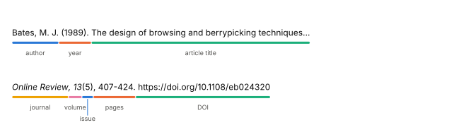

# Units 4 and 5. References {#sec-u4}

::: {.callout-note appearance="default"}
## Objectives
- Create and manage references in academic work.
- Apply a citation style and order the references.
- Know similarity-checking tools and their limits.
:::

::: {.callout-note appearance="simple" icon="false"}
## Unit glossary
[Citation](92-glossary.qmd#gl-cita-texto) · [Reference](92-glossary.qmd#gl-referencia) · [Citation style](92-glossary.qmd#gl-estilo) · [Author-date system](92-glossary.qmd#gl-autor-fecha) · [Numeric system](92-glossary.qmd#gl-numerico) · [DOI](92-glossary.qmd#gl-doi) · [Reference manager](92-glossary.qmd#gl-gestor) · [Similarity-checking tool](92-glossary.qmd#gl-originalidad)
:::

::: {.callout-tip appearance="simple" icon="false"}
## Downloads
[Chapter R script](plantillas/04_references.R){.btn .btn-outline-primary .btn-sm download="04_references.R"}
[Challenge submission template (.qmd)](plantillas/entrega_reto.qmd){.btn .btn-outline-primary .btn-sm download="entrega_reto.qmd"}
[Style theme (.scss)](plantillas/informe.scss){.btn .btn-outline-primary .btn-sm download="informe.scss"}
:::

## Required reading

::: {.lectura}
Gilmour, R.; Cobus-Kuo, L. (2011). [Reference management software: A comparative analysis of four products](https://doi.org/10.5062/F4Z60KZF). *Issues in Science and Technology Librarianship*, 66.
:::

### Further reading {.unnumbered}

- Foltýnek, T. et al. (2020). [Testing of support tools for plagiarism detection](https://doi.org/10.1186/s41239-020-00192-4). *International Journal of Educational Technology in Higher Education*, 17, 46. What similarity-checking tools detect and what they miss.
- American Psychological Association. [APA Style](https://apastyle.apa.org/). Official guide to APA 7 style.

## 1. Why cite

Citing serves to **acknowledge** other people's work, **show** what your statements are based on, **allow** readers to find the sources and **distinguish** your ideas from those of others. Academic work has two related elements:

- The **in-text citation**: a short marker where you use the source, such as (Bates, 1989) or [3].
- The **reference**: the full description of the source in the final list.

## 2. Citation styles

A **style** sets which details are included, in what order and with what punctuation. There are two main systems:

| System | In-text citation | Order of the list | Styles |
|---|---|---|---|
| **Author-date** | (Metzger & Flanagin, 2013) | Alphabetical by surname | APA 7, Harvard, Chicago author-date |
| **Numeric** | [1] or superscript | In order of appearance | Vancouver, IEEE, numeric ISO 690 |

**APA 7th edition** is widely used in this degree. What matters is to choose a style, apply it **consistently** and follow the one required by each lecturer or journal.

{#fig-apa fig-alt="The Bates (1989) reference in APA style, with each part underlined in a colour and labelled below: author, year, article title, journal, volume, issue, pages and DOI."}

## 3. References for the most common document types (APA 7)

| Type | Pattern |
|---|---|
| Journal article | Surname, I. (Year). Title of the article. *Journal*, *volume*(issue), pages. https://doi.org/… |
| Book | Surname, I. (Year). *Title of the book* (ed.). Publisher. |
| Book chapter | Surname, I. (Year). Title of the chapter. In I. Surname (Ed.), *Title of the book* (pp. x-y). Publisher. |
| Web page | Author or organisation. (Year, Month day). *Title*. Website. URL |
| Law | Title of the law. *Official gazette*, number, date. URL |

The **DOI** (*Digital Object Identifier*) is a permanent identifier for a digital document. If there is one, include it as a link `https://doi.org/…`: even if the journal's website changes, the DOI will still lead to the document.

## 4. Reference managers

A **reference manager** stores documents with their details, organises them, inserts citations into the word processor and generates the bibliography in any style. Gilmour and Cobus-Kuo (2011) compared several managers and found that **they all make mistakes** when generating references (capitalisation, missing data, name formats), so **you must always check them**. The most widely used are **[Zotero](https://www.zotero.org/)** (free and open source), Mendeley and EndNote.

A recommended workflow:

1. Capture the reference from the database or the browser (with the manager's connector).
2. Check and complete the details.
3. Organise them in collections and tags.
4. Cite from the word processor with the manager's plug-in.
5. Review the final bibliography.

## 5. Similarity-checking tools

Universities use software that compares assignments with large text databases and flags overlaps. Foltýnek et al. (2020) evaluated many of these tools and concluded that they detect verbatim copying well but struggle with modifications (paraphrase, synonyms, translations), and that none is perfect. The similarity report is an **indication**, not a verdict: a well-made quotation matches its source and is not plagiarism, and an uncited paraphrase may not match and still be plagiarism.

## R practice: building and ordering references

`paste0()` joins text. With it you can see how a manager builds a reference from its data:

```{webr}
#| autorun: true
authors <- "Bates, M. J."
year <- 1989
title <- "The design of browsing and berrypicking techniques for the online search interface"
journal <- "Online Review"; volume <- 13; issue <- 5; pages <- "407-424"
doi <- "10.1108/eb024320"
paste0(authors, " (", year, "). ", title, ". ", journal, ", ", volume, "(", issue, "), ",
       pages, ". https://doi.org/", doi)
```

### Exercise 4.1 {.unnumbered}

In APA style, the list is ordered **alphabetically** by the first author's surname. Sort these references with `sort()` and write which one comes first.

```{webr}
#| exercise: u4_orden
#| setup: true
refs <- c("Pennycook, G., & Rand, D. G. (2021). The psychology of fake news.",
          "Bates, M. J. (1989). The design of browsing and berrypicking techniques.",
          "Metzger, M. J., & Flanagin, A. J. (2013). Credibility and trust of information.",
          "Bawden, D., & Robinson, L. (2009). The dark side of information.")
```

```{webr}
#| exercise: u4_orden
sorted_refs <- ______(refs)
sorted_refs[1]
```

::: {.hint exercise="u4_orden"}
The function that sorts a vector is `sort()`.
:::

::: {.solution exercise="u4_orden"}
```r
sorted_refs <- sort(refs)
sorted_refs[1]
```
Bates (1989): "Bat" comes before "Baw". Managers sort like this, letter by letter.
:::

```{webr}
#| exercise: u4_orden
#| check: true
if (startsWith(as.character(.result), "Bates")) {
  list(correct = TRUE, message = "Correct: Bates comes before Bawden.")
} else {
  list(correct = FALSE, message = "Sort with sort().")
}
```

## Lab: from DOI to reference {#lab-u4-doi}

::: {.laboratorio}
::: {.laboratorio-etiqueta}
Lab · live data from Crossref
:::

Type a DOI and the lab asks [Crossref](https://www.crossref.org/) for the reference in **APA 7**, just as a reference manager does. Then **check it**: look for extra capital letters, missing italics or incomplete data. This is exactly what Gilmour and Cobus-Kuo (2011) found.

```{ojs}
//| echo: false
texto = window.Lab.texto
area = window.Lab.area
seleccion = window.Lab.seleccion
rango = window.Lab.rango
boton = window.Lab.boton
```

```{ojs}
//| echo: false
viewof doi = texto("DOI", {value: "10.1016/j.pragma.2013.07.012", submit: "Get the reference"})
```

```{ojs}
//| echo: false
referencia = {
  const limpio = doi.trim().replace(/^https?:\/\/(dx\.)?doi\.org\//i, "").replace(/^doi:\s*/i, "");
  if (!/^10\.\d{4,9}\/\S+$/.test(limpio)) { yield {aviso: "That does not look like a DOI: DOIs start with \"10.\" followed by a prefix and a slash."}; return; }
  yield {cargando: true};
  try {
    const r = await fetch(`https://api.crossref.org/v1/works/${encodeURIComponent(limpio)}/transform`, {headers: {Accept: "text/x-bibliography; style=apa"}});
    if (r.status === 404) { yield {aviso: "Crossref does not know that DOI. It may belong to another agency (DataCite, for example) or not exist: check it at https://doi.org/" + limpio}; return; }
    yield {texto: (await r.text()).trim(), doi: limpio};
  } catch (e) { yield {aviso: "Crossref could not be reached (are you offline?)."}; }
}
```

```{ojs}
//| echo: false
referencia.cargando ? html`<p role="status">Querying Crossref…</p>` :
referencia.aviso ? html`<p role="status">${referencia.aviso}</p>` :
html`<div role="status"><p><strong>Generated reference:</strong></p><blockquote class="lab-cita">${referencia.texto}</blockquote>
<p class="small">What would you correct? In APA, the article title is in sentence case (capital only for the first word and proper nouns), and the journal and volume are in italics (the formatting is lost here).</p></div>`
```

Also try: `10.1108/eb024320`, `10.1038/s41598-023-41032-5` or the DOI of the Spanish edition of this book, `10.5281/zenodo.24515144` (registered with DataCite, not Crossref).
:::

## Worked examples

::: {.callout-note appearance="simple" icon="false"}
## Example 1 · An APA 7 reference for an article with a DOI, step by step
Article details: authors G. Wilson, J. Bryan, K. Cranston, J. Kitzes, L. Nederbragt and T. K. Teal; year 2017; title "Good enough practices in scientific computing"; journal *PLOS Computational Biology*, volume 13, issue 6, article e1005510; DOI 10.1371/journal.pcbi.1005510.

1. **Authors:** surname and initials, separated by commas, with "&" before the last one (APA 7 includes up to 20 authors).
2. **Year** in parentheses.
3. **Article title** in sentence case (capital only for the first word and proper nouns), not in italics.
4. **Journal and volume in italics**, issue in parentheses, pages or article number.
5. **DOI** as a link.

> Wilson, G., Bryan, J., Cranston, K., Kitzes, J., Nederbragt, L., & Teal, T. K. (2017). Good enough practices in scientific computing. *PLOS Computational Biology, 13*(6), e1005510. https://doi.org/10.1371/journal.pcbi.1005510

**In-text citation:** with three or more authors, only the first one and *et al.*: (Wilson et al., 2017) or Wilson et al. (2017).
:::

::: {.callout-note appearance="simple" icon="false"}
## Example 2 · Other document types (APA 7)
| Type | Structure |
|---|---|
| **Book** | Author, A. (Year). *Title of the book* (ed.). Publisher. |
| **Chapter** | Author, A. (Year). Title of the chapter. In E. Editor (Ed.), *Title of the book* (pp. x-y). Publisher. |
| **Web page** | Author or organisation. (Year, Month day). *Title*. Site. URL |
| **Dataset** | Author, A. (Year). *Title of the dataset* (Version) [Data set]. Repository. https://doi.org/… |
| **Software** | Author, A. (Year). *Name* (Version) [Computer software]. Repository. URL or DOI |

If a document has a DOI, always use it instead of the URL.
:::

::: {.callout-note appearance="simple" icon="false"}
## Example 3 · From search to bibliography with Zotero
1. Install Zotero and its browser connector.
2. From the article or database page, click the connector: Zotero saves the metadata (and the PDF if available). For a DOI, use the magic wand button ("Add item by identifier").
3. **Check the metadata**: title capitalisation, author names, document type. Import errors are common.
4. In the word processor, insert the citations with the Zotero plug-in and generate the bibliography in APA 7 style.
5. Check the final result against the style rules: the manager does not guarantee correct references if the source data are wrong.
:::

## Graded exercises

**Basic.** How do you cite in the text a 2023 work by two authors, García and López?

::: {.webex-solution boton="See solution"}
(García & López, 2023) in parentheses, or García and López (2023) in the narrative. With two authors, both are always cited.
:::

**Intermediate.** Write the APA 7 reference for this dataset: author Marta Ruiz, 2024, "University reading habits survey", version 1.2, deposited in Zenodo with DOI 10.5281/zenodo.0000000 (fictitious DOI).

::: {.webex-solution boton="See solution"}
Ruiz, M. (2024). *University reading habits survey* (Version 1.2) [Data set]. Zenodo. https://doi.org/10.5281/zenodo.0000000
:::

**Advanced.** Import into Zotero ten references on your topic from three different sources, correct their metadata and generate the bibliography in APA 7 and in another style from your field. Note the errors you found.

::: {.webex-solution boton="See guidance"}
Typical errors: titles in capitals, corporate authors split as people, chapters imported as books, missing DOI or pages. Noting them helps you always check what a manager imports.
:::


## Activities

::: {.ordenar #ia-u4-apa titulo="The parts of a journal article reference in APA 7"}
1. Authors
2. Year in parentheses
3. Article title
4. Journal name, in italics
5. Volume, in italics, and issue in parentheses
6. Pages or article number
7. DOI as a link
:::

::: {.clasificar #ia-u4-sistema titulo="Author-date or numeric?" categorias="Author-date|Numeric"}
- (Bates, 1989) → Author-date
- [3] → Numeric
- List ordered alphabetically by surname → Author-date
- List ordered by order of appearance → Numeric
- APA 7 style → Author-date
- Vancouver style → Numeric
- IEEE style → Numeric
- Harvard style → Author-date
:::

::: {.clasificar #ia-u4-tipo titulo="What type of document is it?" categorias="Journal article|Book|Book chapter|Web page|Legislation"}
- Cruz Gil, C. (2015). *Modelos de búsqueda y recuperación de la información*. Trea. → Book
- Bates, M. J. (1989). The design of browsing… *Online Review*, *13*(5), 407-424. → Journal article
- Real Decreto Legislativo 1/1996… *Boletín Oficial del Estado*, 97. → Legislation
- Caulfield, M. (2019, June 19). *SIFT (The four moves)*. Hapgood. → Web page
- Surname, I. (2020). Title. In I. Editor (Ed.), *Title of the book* (pp. 10-25). Publisher. → Book chapter
:::

::: {.callout-warning appearance="simple" icon="false"}
## Common mistakes
- **Mixing styles** in the same piece of work (some references in APA, others copied from the journal's website).
- **Not checking what the manager generates**: titles in capitals, abbreviated journal names or missing authors.
- **Citing the database instead of the document** ("Source: Dialnet").
- **Writing "DOI: 10.…"** instead of the full link `https://doi.org/10.…`.
- **In-text citations without a reference**, or references in the list that are not cited in the text.
:::

## Assessed challenge {#reto-u4}

::: {.callout-important appearance="simple" icon="false"}
## Units 4 and 5 challenge · A bibliography with a reference manager
With the documents from your unit 2 challenge (or another ten on a topic of your choice):

1. Capture them in **Zotero** (or another manager) and organise them in a collection.
2. Generate the bibliography in **APA 7** and check each reference: document **all the errors** you correct.
3. Include at least one article with a DOI, a book, a chapter, a web page and a law.
4. Write a paragraph with three **in-text citations** and explain the difference between the author-date and numeric systems with your own example.

**Submission:** a report made with the [submission template](plantillas/entrega_reto.qmd). It is assessed with the rubric included in the template. This challenge **has no solution in the book**: each student works with different documents and the teaching staff mark it.
:::

## Self-assessment

Answer all the questions and press **Show answers**: correct answers turn green, wrong ones red, and you will see your score. You can change your answers and check again. It does not count towards your mark.

::: {.webex-check .webex-box}
1. In the author-date system, the reference list is ordered 
2. Vancouver and IEEE are styles of the  system
3. The permanent identifier of a digital document included as a link in the reference is the 
4. The references generated by a reference manager are always correct. 
5. In APA 7, the journal title is written in italics. 
6. A similarity report of 0% guarantees that the work contains no plagiarism. 
7. What is the difference between a citation and a reference?



8. In APA 7, a work by three or more authors is cited in the text with "et al." from the first citation. 
9. Which reference manager is free and open source? 
10. In a numeric system, the reference list is ordered by 
:::

::: {.webex-solution boton="See explanations"}
- By the first author's surname.
- They number citations in order of appearance.
- *Digital Object Identifier*, permanent even if the website changes.
- Gilmour and Cobus-Kuo found errors in all of them: they must be checked.
- Journal and volume go in italics.
- An uncited paraphrase may not match and still be plagiarism.
- The citation points to the full reference.
- From the first time, unlike APA 6.
- Zotero is free software.
- The number corresponds to the order of citation.
:::

## Further resources

| Resource | What it is for |
|---|---|
| [APA Style](https://apastyle.apa.org/) | Official guide to APA 7 style |
| [Zotero](https://www.zotero.org/) | Free reference manager |
| [Crossref](https://www.crossref.org/) | DOI registration and metadata search |
| [Appendix: quick citation guide](90-citations.qmd) | APA 7 examples from this book |
