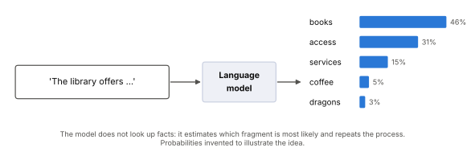
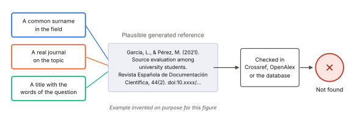

# Units 6 and 7. Generative artificial intelligence: foundations and applications {#sec-u5}

::: {.callout-note appearance="default"}
## Objectives
- Explain what generative AI is and how language models produce text.
- Know its innovative applications, its technical challenges and open lines of research.
- Recognise its responsible uses for study and its limits, especially hallucinations.
- Verify the information and references that an AI produces.
:::

::: {.callout-note appearance="simple" icon="false"}
## Unit glossary
[Generative artificial intelligence](92-glossary.qmd#gl-iag) · [Language model](92-glossary.qmd#gl-llm) · [Prompt](92-glossary.qmd#gl-prompt) · [Hallucination](92-glossary.qmd#gl-alucinacion) · [Training data](92-glossary.qmd#gl-entrenamiento) · [Retrieval-augmented generation](92-glossary.qmd#gl-rag)
:::

::: {.callout-tip appearance="simple" icon="false"}
## Downloads
[Chapter R script](plantillas/05_ai_foundations.R){.btn .btn-outline-primary .btn-sm download="05_ai_foundations.R"}
[Challenge submission template (.qmd)](plantillas/entrega_reto.qmd){.btn .btn-outline-primary .btn-sm download="entrega_reto.qmd"}
[Style theme (.scss)](plantillas/informe.scss){.btn .btn-outline-primary .btn-sm download="informe.scss"}
:::

## Required reading

::: {.lectura}
Walters, W. H.; Wilder, E. I. (2023). [Fabrication and errors in the bibliographic citations generated by ChatGPT](https://doi.org/10.1038/s41598-023-41032-5). *Scientific Reports*, 13, 14045.
:::

### Further reading {.unnumbered}

- Kasneci, E. et al. (2023). [ChatGPT for good? On opportunities and challenges of large language models for education](https://doi.org/10.1016/j.lindif.2023.102274). *Learning and Individual Differences*, 103, 102274.
- Bender, E. M.; Gebru, T.; McMillan-Major, A.; Shmitchell, S. (2021). [On the dangers of stochastic parrots: Can language models be too big?](https://doi.org/10.1145/3442188.3445922) In *Proceedings of FAccT '21* (pp. 610-623). ACM.

::: {.callout-note appearance="simple"}
The generative AI block covers units 6 to 9 of the syllabus. This chapter covers foundations, applications and technical challenges (units 6 and 7); the next one covers ethics, authorship and regulation (units 8 and 9).
:::

## 1. What generative AI is

**Generative artificial intelligence** produces new content (text, images, audio, code) from patterns learned from large amounts of data. Conversational assistants are based on **language models**: systems trained on huge collections of texts to predict the most likely word (in fact, word fragment) that follows a given text. By repeating that prediction again and again, the model writes fluent answers.

Three important consequences follow:

- The model produces what is **plausible**, not necessarily what is **true**. Bender et al. (2021) critically called them "stochastic parrots": they combine linguistic forms without their own access to meaning or facts.
- What it knows depends on its **training data**: it may not know recent facts and may reproduce the biases in those data.
- How you ask matters: a clear **prompt**, with context, goal and format, gives better results.

{#fig-siguiente fig-alt="The text 'The library offers …' goes into a box labelled 'Language model', which returns probability bars for the next word: books 46%, access 31%, services 15%, coffee 5% and dragons 3%. Note: invented probabilities to illustrate the idea."}

Some systems combine the model with a search engine or a document collection and answer from what they retrieve (**retrieval-augmented generation**). This improves currency and makes it possible to link sources, but it does not eliminate errors: you must check that the source says what the system claims.

## 2. Innovative applications and technical challenges

Generative AI is already used to draft and translate texts, summarise documents, write and review code, create images, audio and video, support customer service with conversational assistants and help search for and organise information. In information and documentation, applications include automatic description of collections, transcription of historical documents and search engines that answer in natural language citing their sources.

Its **technical challenges** define the open lines of research:

| Challenge | What it involves |
|---|---|
| **Truthfulness** | Reducing hallucinations and grounding answers in verifiable sources |
| **Currency** | Incorporating information after training without retraining the whole model |
| **Explainability** | Understanding why the model produces a particular answer |
| **Bias** | Detecting and mitigating biases inherited from the data |
| **Efficiency** | Reducing the energy consumption and cost of training and using the models |
| **Evaluation** | Reliably measuring what they can do and where they fail |
| **Detection** | Distinguishing generated content from human content, which cannot be done reliably today |

## 3. Hallucinations

A **hallucination** is an answer that looks correct but is false or invented. In academic work, the most dangerous one is the **fabricated reference**: an article with plausible authors, title, journal and DOI that does not exist. Walters and Wilder (2023) asked ChatGPT for short literature reviews and checked every reference: a large share of GPT-3.5's citations were fabricated, and with GPT-4 a smaller but noticeable proportion remained; in addition, many real references contained errors.

{#fig-alucinacion fig-alt="On the left, three pieces: an author surname from the field, the name of a real journal and a title on the topic. They combine into a complete, plausible reference. An arrow leads to a magnifying glass checking a database, which returns: not found."}

## 4. Responsible uses for study

Kasneci et al. (2023) review opportunities (tailored explanations, writing support, personalised practice) and risks (dependence, errors, bias, plagiarism). A practical criterion is to distinguish uses by what you delegate:

| Use | Risk | Good practice |
|---|---|---|
| Asking it to explain a concept | Medium | Compare with a textbook or a reliable source |
| Generating ideas or an initial outline | Low-medium | Use it as a starting point, not as a result |
| Checking the spelling and clarity of your text | Low | Review each change; the text is still yours |
| Searching for literature | **High** | Verify **every** reference in a database |
| Summarising a document | Medium | Read the original; the summary may omit or invent |
| Writing the assignment for you | **Unacceptable** | It is presenting someone else's work as your own (Unit 3) |

Before using AI in a course, check what the teaching staff allow and declare its use when required (you will see this in the next chapter).

## 5. How to verify what an AI produces

1. **References**: look up each one by its DOI (at `doi.org` or [Crossref](https://www.crossref.org/)) or by its title in Google Scholar, [OpenAlex](https://openalex.org/) or the database for your field. Check authors, year and journal.
2. **Data and facts**: apply lateral reading and SIFT (Unit 1).
3. **Attributed quotations**: find the sentence in the original source.
4. **Content**: check that the real source says what the AI claims it says.

## R practice: checking references against a database

The `%in%` operator checks which elements of one vector are in another. Imagine an AI has given you five DOIs and you have a list of the DOIs that exist in a database:

```{webr}
#| autorun: true
ai_dois <- c("10.1108/eb024320", "10.1016/j.ipm.2019.102041", "10.1038/s41598-023-41032-5",
             "10.1177/0165551508095781", "10.1093/jis/abc123")
database <- c("10.1108/eb024320", "10.1038/s41598-023-41032-5", "10.1177/0165551508095781",
              "10.1016/j.pragma.2013.07.012", "10.1145/1121949.1121979")
ai_dois %in% database
```

### Exercise 6.1 {.unnumbered}

Calculate the **proportion of fabricated references** (those not in the database). Remember that `!` reverses a logical value and that `mean()` of a logical vector gives the proportion of `TRUE`.

```{webr}
#| exercise: u5_inventadas
#| setup: true
ai_dois <- c("10.1108/eb024320", "10.1016/j.ipm.2019.102041", "10.1038/s41598-023-41032-5",
             "10.1177/0165551508095781", "10.1093/jis/abc123")
database <- c("10.1108/eb024320", "10.1038/s41598-023-41032-5", "10.1177/0165551508095781",
              "10.1016/j.pragma.2013.07.012", "10.1145/1121949.1121979")
```

```{webr}
#| exercise: u5_inventadas
mean(!(ai_dois %in% ______))
```

::: {.hint exercise="u5_inventadas"}
Compare with the vector `database`.
:::

::: {.solution exercise="u5_inventadas"}
```r
mean(!(ai_dois %in% database))
```
0.4: two of the five references do not appear. In practice, a DOI missing from a list does not prove it does not exist: you have to look it up at `doi.org`. But a DOI with a strange format or one that does not resolve is a clear sign of a fabricated reference.
:::

```{webr}
#| exercise: u5_inventadas
#| check: true
if (isTRUE(all.equal(as.numeric(.result), 0.4))) {
  list(correct = TRUE, message = "Correct: 40% are not in the database.")
} else {
  list(correct = FALSE, message = "Use database inside %in%.")
}
```

## Lab: a miniature language model {#lab-u5-modelo}

::: {.laboratorio}
::: {.laboratorio-etiqueta}
Lab · runs in your browser
:::

This toy model has "read" only a dozen sentences about libraries and information. For each word it counts which words follow it and how often (a **bigram model**). Choose a starting word and the **temperature**: with low temperature it almost always picks the most likely word; with high temperature it takes more risks. Generate several sentences: you will see fluent and **plausible** texts, some of them false. Large models are vastly more complex, but they share this idea: predicting what comes next, not checking the truth.

```{ojs}
//| echo: false
texto = window.Lab.texto
area = window.Lab.area
seleccion = window.Lab.seleccion
rango = window.Lab.rango
boton = window.Lab.boton
```

```{ojs}
//| echo: false
corpus = `the library offers books and journals to students .
the library offers access to scientific databases .
students search for articles in databases .
students cite the articles with their reference .
the reference includes the author and the year of the article .
the author of the article publishes in a scientific journal .
a scientific journal reviews the articles by peers .
the reviewed articles offer reliable information .
reliable information cites its sources .
disinformation imitates reliable information .
students verify the information in several sources .
the library catalogue offers books and articles .`
modelo = {
  const m = new Map();
  for (const f of corpus.split("\n")) {
    const p = f.trim().split(/\s+/);
    for (let i = 0; i + 1 < p.length; i++) {
      if (!m.has(p[i])) m.set(p[i], new Map());
      const s = m.get(p[i]); s.set(p[i + 1], (s.get(p[i + 1]) || 0) + 1);
    }
  }
  return m;
}
viewof inicio = seleccion("Starting word", [...modelo.keys()].filter(w => w !== ".").sort((a, b) => a.localeCompare(b, "en")), {value: "the"})
viewof temperatura = rango("Temperature", [0.1, 2], {step: 0.1, value: 1})
viewof generar = boton("Generate another sentence")
```

```{ojs}
//| echo: false
probs = (w, t) => {
  const s = modelo.get(w); if (!s) return [];
  const pares = [...s.entries()], pesos = pares.map(([, c]) => Math.pow(c, 1 / t)), z = pesos.reduce((a, b) => a + b, 0);
  return pares.map(([p], i) => [p, pesos[i] / z]).sort((a, b) => b[1] - a[1]);
}
frase = {
  generar;
  const out = [inicio]; let w = inicio;
  for (let k = 0; k < 18 && w !== "."; k++) {
    const ps = probs(w, temperatura); if (!ps.length) break;
    let r = Math.random(), acc = 0, elegido = ps[ps.length - 1][0];
    for (const [p, q] of ps) { acc += q; if (r <= acc) { elegido = p; break; } }
    out.push(elegido); w = elegido;
  }
  return out.join(" ").replace(" .", ".");
}
html`<div role="status"><p><strong>Generated sentence:</strong> "${frase}"</p>
<p><strong>What can follow "${inicio}"</strong> at temperature ${temperatura}:</p>
<table class="table table-sm"><thead><tr><th scope="col">Next word</th><th scope="col">Probability</th><th scope="col"><span class="visually-hidden">Bar</span></th></tr></thead><tbody>
${probs(inicio, temperatura).slice(0, 6).map(([p, q]) => html`<tr><td>${p}</td><td>${(100 * q).toFixed(0)}%</td><td style="width:50%"><div style="height:.8rem;border-radius:2px;background:#2a78d6;width:${100 * q}%"></div></td></tr>`)}
</tbody></table></div>`
```

**Try:** generate sentences from "the" at temperature 2. Do any of them claim something the corpus does not say? That is, on a small scale, a hallucination.
:::

## Lab: verifying references {#lab-u5-verificar}

::: {.laboratorio}
::: {.laboratorio-etiqueta}
Lab · live data from doi.org and Crossref
:::

Paste the DOIs an AI has given you (one per line; the full link also works). The lab checks at **doi.org** whether each DOI exists and, if it is registered with Crossref, retrieves the title and year so you can check that they match what the AI told you.

```{ojs}
//| echo: false
viewof lista = area("DOIs (one per line)", {rows: 5, submit: "Verify",
  value: "10.1038/s41598-023-41032-5\n10.1016/j.ipm.2019.102041\n10.1093/jis/abc123\nhttps://doi.org/10.1145/3442188.3445922"})
```

```{ojs}
//| echo: false
verificacion = {
  const dois = lista.split(/\n+/).map(x => x.trim().replace(/^https?:\/\/(dx\.)?doi\.org\//i, "").replace(/^doi:\s*/i, "")).filter(Boolean).slice(0, 20);
  yield {cargando: true};
  const uno = async d => {
    if (!/^10\.\d{4,9}\/\S+$/.test(d)) return {d, estado: "formato", texto: "Not in DOI format."};
    try {
      const h = await (await fetch("https://doi.org/api/handles/" + encodeURI(d))).json();
      if (h.responseCode !== 1) return {d, estado: "no", texto: "Does not exist at doi.org."};
      try {
        const r = await fetch("https://api.crossref.org/works/" + encodeURIComponent(d));
        if (r.ok) { const m = (await r.json()).message;
          const anio = (m.issued?.["date-parts"]?.[0]?.[0]) ?? "n.d.";
          return {d, estado: "si", texto: `${(m.title || [""])[0]} (${anio}). ${(m["container-title"] || [""])[0]}`}; }
      } catch (e) {}
      return {d, estado: "si", texto: "Exists (registered outside Crossref, for example with DataCite)."};
    } catch (e) { return {d, estado: "error", texto: "Could not be checked (offline?)."}; }
  };
  yield {filas: await Promise.all(dois.map(uno))};
}
```

```{ojs}
//| echo: false
verificacion.cargando ? html`<p role="status">Verifying…</p>` : html`<table class="table table-sm" role="status">
<caption>${verificacion.filas.filter(f => f.estado === "si").length} of ${verificacion.filas.length} DOIs exist</caption>
<thead><tr><th scope="col">DOI</th><th scope="col">Exists?</th><th scope="col">What the record says</th></tr></thead><tbody>
${verificacion.filas.map(f => html`<tr><td><code>${f.d}</code></td><td>${f.estado === "si" ? "✓ Yes" : f.estado === "no" ? "✗ No" : "?"}</td><td>${f.texto}</td></tr>`)}
</tbody></table>`
```

A DOI that exists is not enough: check that **the title, authors and year** match the reference the AI gave you. Walters and Wilder (2023) found, as well as fabricated references, many real references with errors in their details.
:::

## Lab: review your prompt {#lab-u5-prompt}

::: {.laboratorio}
::: {.laboratorio-etiqueta}
Lab · runs in your browser · sends nothing to any AI
:::

A good prompt usually gives **context**, a specific **task**, the **format** of the answer, **limits** and a request for **verification**. Write yours: the lab looks for those pieces by keywords and suggests what to add. It is a rough guide, not a mark.

```{ojs}
//| echo: false
areaP = window.Lab.area
viewof prompt = areaP("Your prompt", {rows: 5, value: "Give me a summary of climate change."})
```

```{ojs}
//| echo: false
{
  const t = prompt.toLowerCase();
  const piezas = [
    ["Context", /\b(i am|i'm|i study|for (a|an|my)|course|degree|module|assignment|level|aimed at|audience)\b/, "Say who you are and what you need it for: \"I am a first-year journalism student preparing a 5-minute presentation\"."],
    ["Specific task", /\b(summari[sz]e|summary|explain|compare|list|identify|classify|propose|review|correct|translate|analy[sz]e|draft|write)\b/, "Use a precise action verb: summarise, compare, classify…"],
    ["Format", /\b(table|list|bullet|bullets|paragraph|paragraphs|words|lines|outline|sections|points)\b|\d+\s*(words|lines|points|ideas)/, "State the format and length: \"in a three-column table\", \"in 150 words\"."],
    ["Limits or sources", /\b(only|without|do not invent|don't invent|based on|from the text|according to|attached|since 20\d\d)\b/, "Set limits: \"based only on the text I paste\", \"without inventing data\"."],
    ["Verification", /\b(cite|sources|references|doi|tell me (if|when)|not sure|uncertain|uncertainty|check|verify)\b/, "Ask it to say where each fact comes from and what it does not know: \"give your sources and tell me if you are not sure\"."]];
  const res = piezas.map(([n, re, consejo]) => [n, re.test(t), consejo]);
  const ok = res.filter((r) => r[1]).length;
  const d = html`<div role="status" aria-live="polite"></div>`;
  d.innerHTML = `<p><strong>${ok} of 5 pieces</strong> detected.</p><ul class="list-unstyled">${res.map(([n, o, c]) => `<li class="mb-1">${o ? "✓" : "○"} <strong>${n}</strong>${o ? "" : ` — ${c}`}</li>`).join("")}</ul>${ok >= 4 ? "<p>A good prompt. Remember: even with a good prompt, verify what the AI answers (section 5).</p>" : ""}`;
  return d;
}
```

Try to improve the example prompt until it has all five pieces and compare it with the one in example 2.
:::

## Worked examples

::: {.callout-note appearance="simple" icon="false"}
## Example 1 · Auditing a bibliography generated by an AI
You ask an assistant for five references on "reproducibility in psychology". Procedure for each reference:

1. **Does it have a DOI?** Open it at `https://doi.org/` followed by the DOI. If it does not resolve, be suspicious.
2. **If it resolves, compare** title, authors, journal and year with what the AI gave: sometimes the DOI exists but belongs to another article.
3. **If it has no DOI**, search for the exact title in quotation marks in Google Scholar, Crossref or OpenAlex.
4. **Classify** each reference: correct, with errors (year, authors, pages) or **fabricated**.
5. **Do not use** any reference you have not located and read at least in its abstract.

**Common result:** some references are real, others mix the authors of one work with the title of another, and one does not exist. This is what is known as a **hallucination**: the model generates plausible text, it does not query a database (unless it uses a search tool, and even then it is worth checking).
:::

::: {.callout-note appearance="simple" icon="false"}
## Example 2 · Improving a prompt
**Vague prompt:** "Tell me about open science".

**Improved prompt:**
> Act as a tutor for an undergraduate student of Information Science. Explain in 300 words what open science is, with three examples of practices (open access, open data, preregistration). Use clear language. Do not include references: I will search for them myself in databases. At the end, suggest three questions to check whether I have understood.

Elements that improve the result: **role**, **audience**, **specific task**, **length**, **format** and **limits** (here, avoiding references that could be fabricated).
:::

::: {.callout-note appearance="simple" icon="false"}
## Example 3 · A figure that sounds right
An AI states: "70% of psychology studies cannot be replicated, according to the 2015 project". Verification: the Open Science Collaboration (2015) project replicated 100 studies and obtained significant results in the same direction in 36% of the replications, compared with 97% of the originals. The AI's figure is a simplification that mixes criteria: you need to go to the source and cite the exact figure with its definition.
:::

## Graded exercises

**Basic.** Why can a language model fabricate a reference that looks correct?

::: {.webex-solution boton="See solution"}
Because it generates the most likely sequence of words from patterns in its training: it produces something shaped like a reference (plausible authors, a real journal, a year) without checking that it exists.
:::

**Intermediate.** Rewrite this prompt so that it is useful and safe: "Write the literature review for my bachelor's thesis".

::: {.webex-solution boton="See solution"}
Example: "My bachelor's thesis is about [topic]. Propose a five-section structure for the literature review, with the key concepts of each section and the search terms I should use in Dialnet and Scopus. Do not write the text and do not invent references". This way the AI helps you plan and does not replace your work.
:::

**Advanced.** Ask two different AI assistants for ten references on a topic you are interested in, audit them all with the procedure in example 1 and compare the error rates.

::: {.webex-solution boton="See guidance"}
Present a table with each reference, its status (correct, with errors, fabricated) and the evidence (DOI, search). State the date and the model used: results change between versions.
:::


## Activities

::: {.clasificar #ia-u5-riesgo titulo="How risky is this use?" categorias="Low|Medium|High|Unacceptable"}
- Asking it to check the spelling of a text you wrote → Low
- Asking it to explain a concept you do not understand → Medium // Check the explanation against a reliable source.
- Asking for a list of references for your assignment and copying it without checking → High // Many may be fabricated.
- Asking it to summarise an article you are not going to read → Medium // The summary may omit or invent.
- Submitting work written by the AI as your own → Unacceptable
- Generating ideas to choose the topic of your assignment → Low
- Uploading your group members' personal data so that it assigns tasks → High // It puts other people's privacy at risk.
:::

::: {.clasificar #ia-u5-reto titulo="Which technical challenge is it?" categorias="Truthfulness|Currency|Explainability|Bias|Efficiency|Detection"}
- The assistant does not know who won an election last month → Currency
- Nobody can explain why the model chose that answer → Explainability
- The model associates "nurse" with women and "surgeon" with men → Bias
- Training a large model uses as much electricity as hundreds of homes in a year → Efficiency
- A lecturer cannot know for sure whether a text was written by an AI → Detection
- The model cites an article that does not exist → Truthfulness
:::

::: {.callout-warning appearance="simple" icon="false"}
## Common mistakes
- **Using AI as a literature search engine** without verifying each reference.
- **Asking the AI itself whether the reference exists**: it may confirm it with complete confidence even if it is false.
- **Taking fluency for accuracy**: a well-written text is not a true text.
- **Delegating what the course wants you to learn.** AI can help you learn, not learn for you.
- **Not declaring its use** when the teaching staff require it (next chapter).
:::

## Assessed challenge {#reto-u5}

::: {.callout-important appearance="simple" icon="false"}
## Units 6 and 7 challenge · Auditing an AI's references
1. Ask a generative AI assistant for a list of **ten academic references** on a topic you are interested in. Save the full prompt and answer.
2. Verify **each reference**: does it exist? Are the authors, year, title, journal and DOI correct? Does the content match the topic?
3. Classify each one as **correct**, **real with errors** or **fabricated**, and calculate the proportions.
4. Repeat the search in a database (Unit 2) and compare the quality of the results and the time taken.

**Submission:** a report made with the [submission template](plantillas/entrega_reto.qmd). It is assessed with the rubric included in the template. This challenge **has no solution in the book**: each student works on a different topic and the teaching staff mark it.
:::

## Self-assessment

Answer all the questions and press **Show answers**: correct answers turn green, wrong ones red, and you will see your score. You can change your answers and check again. It does not count towards your mark.

::: {.webex-check .webex-box}
1. A language model generates text by predicting the most likely fragment that follows a given text. 
2. An AI answer that looks correct but is false or invented is called a 
3. If an AI gives a reference with a DOI, authors and journal, the reference exists. 
4. Which of these uses is riskiest? 
5. If 3 of 12 references generated by an AI are fabricated, the proportion fabricated is 
6. Retrieval-augmented generation completely eliminates errors. 
7. Why can a language model fabricate a plausible reference?



8. What a language model knows depends on its  data
9. Detectors exist today that distinguish AI-generated text from human text with complete reliability. 
10. To check whether a reference given by an AI exists, the most reliable approach is to 
:::

::: {.webex-solution boton="See explanations"}
- It repeats that prediction to write the answer.
- A plausible but false answer.
- It may be fabricated: it must be verified.
- Walters and Wilder found many fabricated references.
- 3 / 12 = 0.25.
- It improves currency, but sources must be checked.
- It produces what is plausible, not what is true; there is no intent.
- It may not know recent facts and may inherit their biases.
- Detection is one of the open technical challenges.
- The AI may confidently confirm a false reference.
:::

## Further resources

| Resource | What it is for |
|---|---|
| [Crossref](https://www.crossref.org/) | Checking DOIs and metadata |
| [OpenAlex](https://openalex.org/) | Checking whether an article exists |
| [UNESCO – Guidance for generative AI in education and research (Miao & Holmes, 2023)](https://unesdoc.unesco.org/ark:/48223/pf0000386693) | International guidance |
