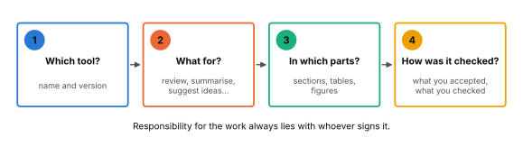
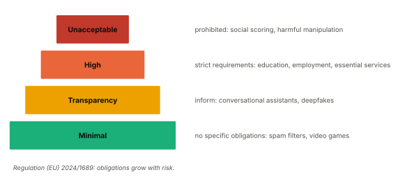

# Units 8 and 9. Generative artificial intelligence: ethics, authorship and regulation {#sec-u6}

::: {.callout-note appearance="default"}
## Objectives
- Analyse the ethical principles of generative AI: consent, privacy and informational self-determination.
- Understand responsibility and authorship in the use of AI.
- Declare the use of AI transparently in academic work.
- Know the European regulatory framework and the ethical principles of AI.
:::

::: {.callout-note appearance="simple" icon="false"}
## Unit glossary
[Algorithmic bias](92-glossary.qmd#gl-sesgo) · [AI use statement](92-glossary.qmd#gl-declaracion) · [AI Act](92-glossary.qmd#gl-aiact) · [AI literacy](92-glossary.qmd#gl-alfia) · [Explainability](92-glossary.qmd#gl-explicabilidad) · [Personal data](92-glossary.qmd#gl-personales) · [Informational self-determination](92-glossary.qmd#gl-autodeterminacion)
:::

::: {.callout-tip appearance="simple" icon="false"}
## Downloads
[Challenge submission template (.qmd)](plantillas/entrega_reto.qmd){.btn .btn-outline-primary .btn-sm download="entrega_reto.qmd"}
[Style theme (.scss)](plantillas/informe.scss){.btn .btn-outline-primary .btn-sm download="informe.scss"}
:::

## Required reading

::: {.lectura}
Floridi, L.; Cowls, J. (2019). [A unified framework of five principles for AI in society](https://doi.org/10.1162/99608f92.8cd550d1). *Harvard Data Science Review*, 1(1).
:::

### Further reading {.unnumbered}

- [Regulation (EU) 2024/1689 laying down harmonised rules on artificial intelligence](https://eur-lex.europa.eu/eli/reg/2024/1689/oj). *Official Journal of the European Union*.
- @bender2021a — Environmental costs and biases of large models.

## 1. Ethical principles of AI

@floridi2019 compared the main international statements on AI ethics and summarised them in **five principles**:

| Principle | What it means |
|---|---|
| **Beneficence** | Promoting the well-being of people and the planet |
| **Non-maleficence** | Avoiding harm: privacy, security, misuse |
| **Autonomy** | People keep the power to decide |
| **Justice** | Sharing benefits, avoiding discrimination |
| **Explicability** | Being able to understand how it works and who is accountable |

The first four come from bioethics; the fifth is specific to AI and makes the others possible.

## 2. Ethical risks in everyday use

- **Bias**: models reproduce the biases in their training data (gender, origin, language). An answer can look neutral and be biased underneath.
- **Consent, privacy and informational self-determination**: **informational self-determination** is each person's right to decide what is done with their personal data; in Spain, the Constitutional Court recognises it as the fundamental right to data protection. Models are often trained on data collected from the internet without their authors' consent, and what you write into an assistant may be stored and, depending on the service, used to train models. Do not enter your own or other people's personal data, or confidential documents, and check the service's privacy settings.
- **Authorship and intellectual property**: a generated text is not yours; moreover, models are trained on protected works, an open legal debate.
- **Dependence and learning**: delegating to AI what the course wants you to learn prevents you from learning it.
- **Environmental cost**: training and using large models consumes a lot of energy and water [@bender2021].

## 3. Responsibility, authorship and transparency

In academic work, the general rule is **transparency**: if you use AI, say so, explain what for and take responsibility for the result. Scientific publishers and COPE (Committee on Publication Ethics) agree that an AI **cannot be an author**, because it cannot take responsibility for the work.

A useful statement says **which tool** (and version), **what for** it was used, **in which parts** and **how** the result was checked. For example:

> AI use statement: I used [tool, version] to check the spelling and clarity of sections 2 and 3, and to suggest synonyms in the table of search terms. I reviewed and accepted or rejected each suggestion. The searches, the selection of documents and the conclusions are my own. I did not enter any personal data.

If the AI influences the content, APA also recommends citing it in the text and in the references, giving the prompt used in an appendix or in the text.

{#fig-declaracion fig-alt="Four cards in a row with the questions of an AI use statement: which tool and version, what it was used for, in which parts of the work and how the result was checked. Below, a note: responsibility for the work always lies with whoever signs it."}

## 4. The European regulatory framework

**Regulation (EU) 2024/1689** on Artificial Intelligence (*AI Act*) is the first comprehensive law on AI. It follows a **risk-based approach**:

| Risk level | Examples | Consequence |
|---|---|---|
| **Unacceptable** | Social scoring, manipulation causing harm | Prohibited |
| **High** | AI in education to assess or admit students, in employment, in essential services | Strict requirements: risk management, quality data, human oversight |
| **Transparency** | Conversational assistants, generated content (*deepfakes*) | Informing people that they are interacting with an AI or that the content is artificial |
| **Minimal** | Spam filters, video games | No specific obligations |

{#fig-riesgos fig-alt="Four-level pyramid, from top to bottom: unacceptable (prohibited: social scoring, harmful manipulation), high (strict requirements: education, employment, essential services), transparency (inform: conversational assistants, deepfakes) and minimal (no specific obligations: spam filters, video games)."}

The regulation also covers **general-purpose AI models** (the ones behind assistants) and requires those who deploy AI systems to ensure that their staff have a sufficient level of **AI literacy**. Its obligations apply in stages from 2025. Other rules, such as the General Data Protection Regulation, continue to apply to AI.

## Worked examples

::: {.callout-note appearance="simple" icon="false"}
## Example 1 · Writing an AI use statement
In your bachelor's thesis you used an AI assistant to check spelling and to suggest an initial structure for the table of contents. A suitable statement:

> During the preparation of this work, [name of the tool, version] was used to check the spelling and grammar of the text and to obtain an initial proposal for the structure of the table of contents, which was modified by the author. All content was written, reviewed and verified by the author, who takes responsibility for the work. AI was not used to generate results, analyses or references.

Key elements: **which tool**, **for which tasks**, **what you did** and **responsibility**. Always check your university's and your course's rules.
:::

::: {.callout-note appearance="simple" icon="false"}
## Example 2 · Personal data in a chatbot
To analyse the open-ended answers of a survey, you plan to paste them into a commercial chatbot. They contain names and comments about the participants' health. Problems: they are **personal data**, some of them in a **special category** (health), and the GDPR requires a legal basis, information to participants and guarantees about where and how the data are processed. Alternatives: **anonymise** first (remove names and identifiable information), use tools approved by the university with contractual guarantees or do the analysis locally. When in doubt, ask the data protection officer.
:::

::: {.callout-note appearance="simple" icon="false"}
## Example 3 · Which risk category? (EU AI Act)
Regulation (EU) 2024/1689 classifies uses of AI by their risk:

| Category | Examples | Consequence |
|---|---|---|
| **Unacceptable risk** | Social scoring of people; manipulation that causes harm | Prohibited |
| **High risk** | AI to decide access to education or to assess students; recruitment | Strict requirements: risk management, data, human oversight, transparency |
| **Transparency risk** | Chatbots; generated or manipulated content (deepfakes) | Informing people that they are interacting with an AI or that the content is artificial |
| **Minimal risk** | Spam filters, video games | No specific obligations |

A system that automatically marks exams and decides the grade would be in the **high-risk** category.
:::

## Graded exercises

**Basic.** Who is responsible for the content of work done with the help of an AI?

::: {.webex-solution boton="See solution"}
The author. The AI cannot be an author or take responsibility; whoever signs the work answers for its accuracy and originality.
:::

**Intermediate.** Classify according to the categories of the Regulation: (a) a student support chatbot; (b) a system that decides admission to a master's programme; (c) a spell checker.

::: {.webex-solution boton="See solution"}
(a) Transparency risk: it must say that it is an AI. (b) High risk: it affects access to education. (c) Minimal risk.
:::

**Advanced.** Analyse a real or realistic case of AI use in your academic environment with the chapter's ethical principles and propose a short policy for your course or group.

::: {.webex-solution boton="See guidance"}
A good policy says which uses are allowed and which are not, how they are declared, what happens to personal data and how the work is verified. It must be consistent with the university's rules.
:::

## Activities

::: {.clasificar #ia-u6-riesgo titulo="What risk level does the AI Act assign?" categorias="Unacceptable (prohibited)|High|Transparency|Minimal"}
- A system that scores citizens on their social behaviour to grant or deny them services → Unacceptable (prohibited)
- A system that decides student admission to a master's programme → High
- A system that marks and grades university exams → High
- A conversational assistant on a city council website → Transparency // It must say that you are talking to an AI.
- An AI-generated video imitating a real person (*deepfake*) → Transparency // It must be labelled as artificial.
- A spam filter → Minimal
- A system that screens CVs in a recruitment process → High
- A system that subliminally manipulates people and causes them harm → Unacceptable (prohibited)
:::

::: {.clasificar #ia-u6-principios titulo="Which of Floridi and Cowls' principles is at stake?" categorias="Beneficence|Non-maleficence|Autonomy|Justice|Explicability"}
- A grant system rejects a student and nobody can explain why → Explicability
- A recruitment model penalises women's CVs → Justice
- An assistant leaks users' personal data in its answers → Non-maleficence
- An app decides which courses you take without you being able to change it → Autonomy
- A system helps detect early school drop-out in time to offer support → Beneficence
:::

::: {.escenario #ia-u6-declarar titulo="Does it need to be declared?"}
You are finishing the final assignment for a course. The course guide asks you to declare any use of generative AI.

### What you have done {#u6d-inicio}
You used an assistant to correct your spelling and suggest synonyms in the table of search terms. You did everything else yourself.

- [I do not declare it: it was only spelling](#u6d-nodeclara)
- [I declare it, stating the tool, what for and in which parts](#u6d-declara)

### Not declared {#u6d-nodeclara .final .mal}
The guide asks you to declare **any** use. Even if the use is minor and legitimate, hiding it breaks the course rules and may be treated as a breach of integrity.

### The statement {#u6d-declara}
How do you write it?

- ["I used AI."](#u6d-vaga)
- ["I used (tool and version) to check spelling and suggest synonyms in the table in section 2. I reviewed each change; the search, the selection and the conclusions are my own."](#u6d-buena)

### Too vague {#u6d-vaga .final .regular}
Readers do not know which part is yours. State which tool, what for, in which parts and how you checked the result.

### Complete statement {#u6d-buena .final .bien}
Transparent, specific and taking responsibility for the result: exactly what scientific publishers and COPE ask for.
:::

::: {.callout-warning appearance="simple" icon="false"}
## Common mistakes
- **Thinking that "declaring" means "confessing".** Declaring a permitted use is good practice, not misconduct.
- **Believing the statement shifts responsibility to the tool.** Whoever signs answers for the whole work.
- **Entering personal or confidential data** into services that may use it to train models.
- **Assuming the AI Act only affects technology companies**: it also places obligations on those who use (deploy) high-risk systems, such as a university.
:::

## Practice

Find UC3M's or your course's AI use policy and the AI policy of a journal in your field. Compare them: what do they allow, what do they prohibit and what do they ask you to declare?

## Assessed challenge {#reto-u6}

::: {.callout-important appearance="simple" icon="false"}
## Units 8 and 9 challenge · An ethical case and a use statement
1. Choose a **real case** of generative AI use with ethical problems (in education, journalism, science or culture), documented in at least two reliable sources.
2. Analyse it with Floridi and Cowls' **five principles**.
3. Place it in the **risk levels** of the EU AI Act and explain which obligations would apply.
4. Write the **AI use statement** for your own report (even if you have not used any, say so explicitly).

**Submission:** a report made with the [submission template](plantillas/entrega_reto.qmd). It is assessed with the rubric included in the template. This challenge **has no solution in the book**: each student analyses a different case and the teaching staff mark it.
:::

## Self-assessment

Answer all the questions and press **Show answers**: correct answers turn green, wrong ones red, and you will see your score. You can change your answers and check again. It does not count towards your mark.

::: {.webex-check .webex-box}
1. The principle that Floridi and Cowls add to the four from bioethics is 
2. An AI can be listed as co-author of a scientific article if it has written much of the text. 
3. Under the EU AI Act, an AI system used to assess students is  risk
4. Social scoring of people is 
5. It is good practice to enter classmates' personal data into an AI assistant so it can write a group assignment. 
6. The EU AI Act follows an approach based on 
7. What should an AI use statement include?



8. Each person's right to decide on the use of their personal data is called informational 
9. Informing people that content has been generated by AI is an obligation of the  risk level
10. If you declare your use of AI, you are no longer responsible for any errors in the work. 
:::

::: {.webex-solution boton="See explanations"}
- It makes the other four principles possible.
- Authorship requires responsibility, and an AI cannot take it on.
- Education and the assessment of students are high-risk areas.
- It is a prohibited practice.
- It puts other people's privacy at risk.
- Obligations grow with the risk.
- This way readers know what is yours and what is not.
- The basis of the right to data protection.
- It affects assistants and synthetic content.
- Responsibility remains with whoever signs.
:::

## Further resources

| Resource | What it is for |
|---|---|
| [Regulation (EU) 2024/1689](https://eur-lex.europa.eu/eli/reg/2024/1689/oj) | Official text of the AI Act |
| [COPE – Authorship and AI tools](https://publicationethics.org/cope-position-statements/ai-author) | Position on AI and authorship |
| [APA Style – How to cite ChatGPT](https://apastyle.apa.org/blog/how-to-cite-chatgpt) | Citing AI-generated content |
| [UNESCO – Recommendation on the Ethics of AI](https://www.unesco.org/en/artificial-intelligence/recommendation-ethics) | International ethical framework |
